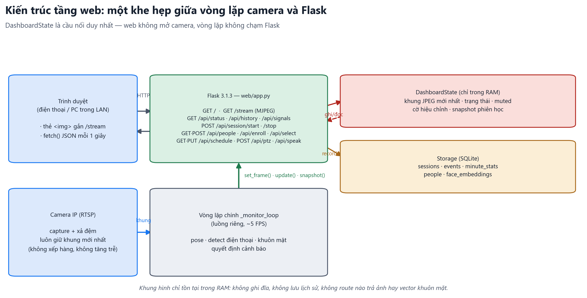
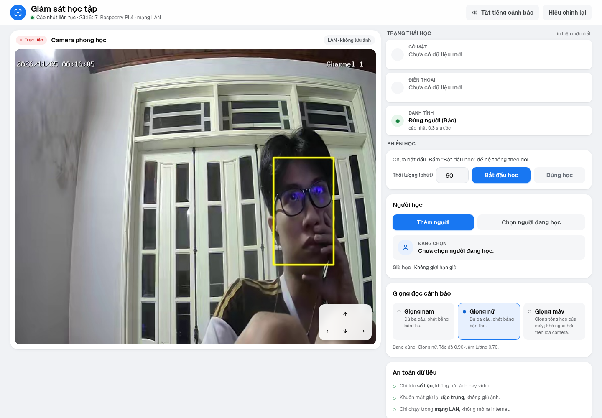
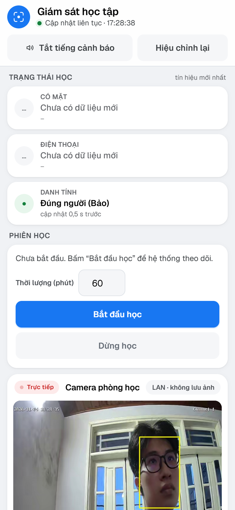
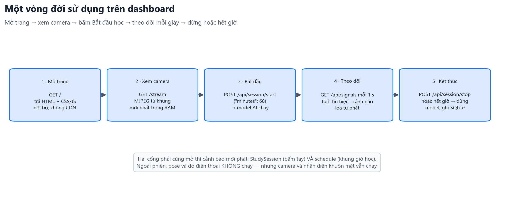
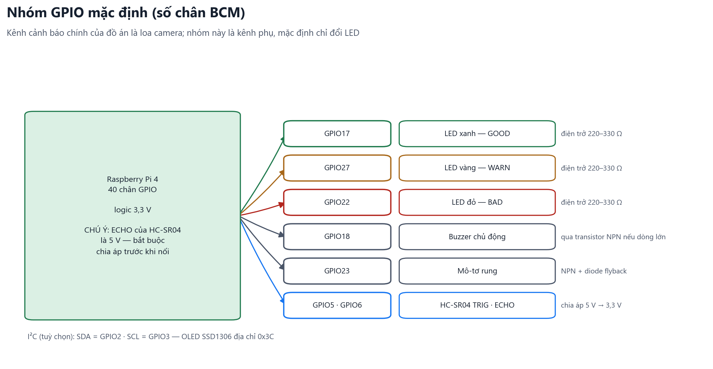

# BÁO CÁO ĐỒ ÁN

## Hệ thống giám sát học tập trên Raspberry Pi 4

**Phiên bản tài liệu:** 1.0 · **Ngày:** 11/11/2026
**Mã nguồn:** `src/posture_monitor/` · **Tài liệu kỹ thuật gốc:** `docs/SPEC_V2.md`, `docs/SPEC_V3.md`, `docs/WEB_DASHBOARD.md`

---

## Mục lục

> Bản **.docx** (`BaoCao_DoAn_GiamSatHocTap.docx`) dùng **mục lục tự động của Word**:
> mở tệp rồi nhấn `F9` (hoặc chuột phải → *Update Field*) để dựng số trang. Danh sách
> dưới đây là mục lục của bản Markdown.

| Chương | Nội dung | Trọng tâm |
|---|---|---|
| **1** | Tổng quan hệ thống | Bài toán, mục tiêu, phạm vi, kiến trúc bốn tầng, môi trường, quy ước số liệu |
| **2** | Phần model AI | YOLO11n-pose, YOLO11n detect (điện thoại), YuNet + SFace, presence, bộ luật tư thế, ngân sách FPS |
| **3** | Phần web: backend và frontend | Flask, `DashboardState`, 24 route, luồng MJPEG, giao diện, phiên học, quyền riêng tư |
| **4** | Phần cứng | Camera IP RTSP, Raspberry Pi 4, loa camera (backchannel), PTZ, GPIO, siêu âm, SQLite |
| **5** | Kiểm thử, đánh giá, hướng phát triển | 1.667 bài test Python + 158 bài test app, benchmark, đối chiếu nghiệm thu, hạn chế |
| **6** | Ứng dụng di động | React Native/Expo Go trên iOS: 8 màn hình, 10 route, hai chế độ xem camera |
| **PL** | Phụ lục | Cấu hình mẫu, lệnh chạy, thuật ngữ, nguồn tài liệu, giấy phép |

Danh sách chi tiết theo số mục:

- **Chương 1** — 1.1 Bài toán · 1.2 Mục tiêu kỹ thuật · 1.3 Phạm vi · 1.4 Kiến trúc tổng thể · 1.5 Môi trường triển khai · 1.6 Quy ước số liệu
- **Chương 2** — 2.1 Các thành phần model · 2.2 YOLO11n-pose · 2.3 YOLO11n detect · 2.4 YuNet + SFace · 2.5 Presence · 2.6 Bộ luật tư thế v2 · 2.7 Luồng xử lý · 2.8 Ngân sách thời gian và FPS · 2.9 Khoảng trống đã biết
- **Chương 3** — 3.1 Kiến trúc · 3.2 DashboardState · 3.3 Danh mục route · 3.4 Luồng MJPEG · 3.5 Frontend · 3.6 Phiên học · 3.7 Dữ liệu và quyền riêng tư · 3.8 Các phần chưa nối
- **Chương 4** — 4.1 Chuỗi phần cứng · 4.2 Camera IP qua RTSP · 4.3 Raspberry Pi 4 · 4.4 Loa camera · 4.5 PTZ · 4.6 GPIO và siêu âm · 4.7 Lưu trữ · 4.8 Rủi ro phần cứng
- **Chương 5** — 5.1 Bộ kiểm thử · 5.2 Đo lường · 5.3 Đối chiếu nghiệm thu · 5.4 Hạn chế · 5.5 Hướng phát triển · 5.6 Bài học số liệu · 5.7 Kết luận
- **Chương 6** — 6.1 Vì sao có tầng này · 6.2 Chọn nền tảng · 6.3 Kiến trúc · 6.4 Tám màn hình · 6.5 Hai thay đổi phía máy chủ · 6.6 Kiểm thử không cần node_modules · 6.7 Hai lỗi thật · 6.8 Chưa kiểm chứng

---

## Chương 1 — Tổng quan hệ thống

### 1.1 Bài toán

Một người ngồi học một mình trước bàn. Camera IP gắn ở góc trước mặt bàn sao cho khung
hình thấy được **cả người ngồi và mặt bàn**. Trong phiên học, hệ thống phải trả lời ba
câu hỏi ở nhịp vài giây một lần:

1. Người đang học có **còn trong khung hình** không?
2. Người đó có **đang dùng điện thoại** không?
3. Người đang ngồi có **đúng là người đã đăng ký học** không?

Khi câu trả lời là "không tốt" và kéo dài đủ lâu, hệ thống **phát cảnh báo bằng tiếng
ra loa của camera IP**, đồng thời hiện trạng thái trên dashboard web trong mạng LAN và
ghi số liệu vào SQLite.

### 1.2 Mục tiêu kỹ thuật

| # | Mục tiêu | Cách hiện thực |
|---|---|---|
| 1 | Chạy ổn định trên Raspberry Pi 4, **không GPU** | Ba model pretrained, chuyển sang định dạng NCNN, `imgsz` 320 |
| 2 | Không huấn luyện lại model | Chỉ dùng suy luận; "cập nhật bộ nhận diện" = tính lại embedding, không fine-tune |
| 3 | Ảnh **không rời khỏi máy**, **không lưu ra đĩa** | Khung hình chỉ tồn tại trong RAM; SQLite chỉ chứa số liệu |
| 4 | Mọi ngưỡng nằm trong cấu hình | `config.yaml` + `src/posture_monitor/config.py`; không viết cứng trong thuật toán |
| 5 | Tái sử dụng hạ tầng đã chạy được | Phiên bản v3 kế thừa capture RTSP, vòng lặp, web, PTZ, loa camera của v2 |

### 1.3 Phạm vi

**Trong phạm vi**

| # | Chức năng |
|---|---|
| 1 | Nhận diện người ngồi có mặt / vắng mặt trong khung |
| 2 | Cảnh báo ra **loa camera** khi: ra khỏi khung, dùng điện thoại, người khác ngồi học hộ |
| 3 | Phát hiện dùng điện thoại bằng YOLO detect (lớp `cell phone`) + keypoint cổ tay |
| 4 | Nhận diện khuôn mặt người đang ngồi với người đã đăng ký (YuNet + SFace) |
| 5 | Web server hiển thị luồng camera (chức năng chính, bật mặc định) |
| 6 | Thêm người mới: bấm nút, camera hướng dẫn năm tư thế, cập nhật bộ nhận diện |
| 7 | Chọn người đang học trong khung hình |
| 8 | Điều khiển PTZ trái/phải/lên/xuống ngay trong dashboard |
| 9 | Khung giờ học cấu hình được (lịch theo tuần) |
| 10 | Phiên học bật/tắt bằng tay — công tắc duy nhất bật model AI |
| 11 | **Ứng dụng di động (React Native / Expo Go)** xem trạng thái, ảnh camera, bấm phiên học, xem lịch sử vi phạm |

**Ngoài phạm vi**

- Nhận diện hành vi khác (quay cóp, ngủ gật, nói chuyện).
- Chấm điểm, xếp hạng, báo cáo phụ huynh qua Internet, cloud.
- Huấn luyện/fine-tune model khuôn mặt hay model detect.
- Chống giả mạo khuôn mặt (ảnh in, video replay) — **ghi nhận là lỗ hổng đã biết**.
- Theo dõi nhiều người học cùng lúc: hệ thống chỉ giám sát **một** người được chọn.
- Ứng dụng di động **không** chạy model AI trên điện thoại: mọi suy luận vẫn trên
  Raspberry Pi, app chỉ là client HTTP của dashboard (chương 6).

### 1.4 Kiến trúc tổng thể

Hệ thống chia làm bốn tầng, tương ứng bốn phần của báo cáo này.


*Hình 1 — Bốn tầng: phần cứng · model AI · điều phối và web backend · giao diện người dùng.*

Bản đồ module theo bốn phần, dùng làm mục lục kỹ thuật khi đọc mã nguồn:


*Hình 2 — Mỗi phần báo cáo ứng với một nhóm tệp trong `src/posture_monitor/`.*

Bốn nguyên tắc kiến trúc chi phối toàn bộ mã nguồn:

1. **Khung mới nhất, không xếp hàng.** Luồng đọc camera luôn ghi đè khung cũ, nên độ
   trễ không tăng dần. Đây là điều kiện để cảnh báo còn kịp thời.
2. **Một khe hẹp giữa vòng lặp và web.** `DashboardState` là cầu nối duy nhất: web
   không bao giờ mở camera, vòng lặp không bao giờ chạm Flask. Nhờ vậy test được mà
   không cần phần cứng.
3. **Không có ảnh trên đĩa.** Không hàm nào ghi khung hình ra tệp; SQLite không có cột
   chứa dữ liệu hình; chỉ embedding khuôn mặt (vector số thực) được lưu.
4. **Thiếu gì cũng không được crash.** Thiếu camera, thiếu GPIO, thiếu thư viện, hỏng
   model đều có đường rơi về an toàn kèm log rõ nguyên nhân.

### 1.5 Môi trường triển khai

| Hạng mục | Giá trị | Nhãn |
|---|---|---|
| Bo mạch | Raspberry Pi 4 Model B **Rev 1.5** | ĐÃ ĐO |
| Kiến trúc | `aarch64` (có `crc32`) | ĐÃ ĐO |
| RAM | **3795 MB** | ĐÃ ĐO |
| Đĩa trống | 7,6 GB (thời điểm đo) | ĐÃ ĐO |
| Hệ điều hành | Raspberry Pi OS **Trixie** (Debian 13), kernel `6.18.34+rpt-rpi-v8` | ĐÃ ĐO |
| Python | **3.13.5** | ĐÃ ĐO |
| Nhóm user | `video gpio i2c spi dialout` | — |
| Camera | Camera IP RTSP, luồng phụ `/1/2` **704×576 @ 20 fps, HEVC** | ĐÃ ĐO |
| Nhiệt khi tải | **55,0 → 58,0 °C**; max **58,9 °C** trong lần chạy 60 giây | ĐÃ ĐO |
| Throttle | `vcgencmd get_throttled` = **`0x0`** mỗi lần lấy mẫu | ĐÃ ĐO |
| RAM tiến trình | peak **464,0 MiB** (lần chạy 60 giây, pipeline chỉ pose) | ĐÃ ĐO |

### 1.6 Quy ước số liệu — đọc trước khi đọc số

Tài liệu này phân biệt ba loại số. Quy ước này không phải hình thức: nó là kết quả của
một đợt đính chính số liệu đã ghi sai (xem §5.6).

| Nhãn | Nghĩa | Được dùng để |
|---|---|---|
| **ĐÃ ĐO** | Số đo thực trên chính Pi 4 của dự án, có người đo, có ngày | Làm căn cứ thiết kế và nghiệm thu |
| **TÍNH TỪ ĐO** | Số học suy ra từ số ĐÃ ĐO (cộng, chia, trung bình) | Lập kế hoạch, kèm công thức |
| **CHƯA ĐO** | Không có bài đo nào | Chỉ dùng để lập kế hoạch; **không** dùng nghiệm thu |

Mọi con số hiệu năng trong báo cáo này đều truy được về `docs/SPEC_V2.md` §14 hoặc
`docs/SPEC_V3.md` §4.2–§4.3, §16. Không có số nào lấy từ blog hay README của dự án khác.

---

## Chương 2 — Phần model AI

### 2.1 Các thành phần model

Hệ thống dùng bốn tệp trọng số, tất cả đều là model **pretrained**, không huấn luyện lại.

| Model | Tệp | Kích thước | Định dạng | Vai trò | Chu kỳ chạy |
|---|---|---|---|---|---|
| YOLO11n-pose | `yolo11n-pose.pt` → `yolo11n-pose_ncnn_model/` | 6,26 MB → 11,5 MB | PyTorch → **NCNN** | 17 keypoint + hộp bao người | **mỗi khung** |
| YOLO11n detect | `yolo11n.pt` → `yolo11n_ncnn_model/` | 5,61 MB → 10,5 MB | PyTorch → **NCNN** | Dò lớp `cell phone` (COCO 67) | **1/2 khung** |
| YuNet | `yunet.onnx` | 232.589 B | ONNX (OpenCV Zoo) | Phát hiện khuôn mặt + 5 điểm mốc | mỗi 2 s |
| SFace | `sface.onnx` | 38.696.353 B | ONNX (OpenCV Zoo) | Trích embedding **128 chiều** | mỗi 2 s |

Ba tham số chung của hai model YOLO: `imgsz = 320`, ngưỡng phát hiện `conf = 0,25`
(hằng số trong `pose.py`, không nằm trong cấu hình vì đây là ngưỡng của model chứ không
phải ngưỡng phân loại hành vi), `verbose = False`.

**Cơ chế rơi về an toàn.** Cả hai model YOLO nạp theo thứ tự `NCNN → ONNX → PyTorch`.
Nếu thư mục NCNN chưa có, hệ thống tự export một lần với `imgsz` đang cấu hình; export
lỗi thì rơi xuống ONNX, rồi `.pt`. Mỗi lần rơi đều ghi WARNING nêu rõ lý do; chỉ khi
**cả ba** backend đều hỏng mới ném `PoseError` để CLI báo lỗi cấu hình. Trên chính Pi 4
của dự án, export NCNN mất **42,8 giây** và cho thư mục **11,1 MB** (ĐÃ ĐO).

### 2.2 YOLO11n-pose — xương sống của tầng nhận thức

Model có **một lớp duy nhất** (`person`) và trả về 17 keypoint COCO kèm độ tin cậy.

```
PoseResult  (NamedTuple)
├── xy   : ndarray (17, 2)  float32 — toạ độ pixel trên khung GỐC
├── conf : ndarray (17,)    float32 — độ tin cậy từng điểm, trong [0, 1]
└── bbox : ndarray (4,)     float32 — x1, y1, x2, y2
```

Thứ tự 17 keypoint: mũi · mắt trái/phải · tai trái/phải · vai trái/phải · khuỷu
trái/phải · **cổ tay trái/phải** · hông trái/phải · gối trái/phải · cổ chân trái/phải.
Chỉ số 9 và 10 (cổ tay) là đầu vào của bộ phát hiện điện thoại.

**Chọn người khi khung có nhiều người.** Đây là chỗ dễ sai nhất và đã được xử lý hai
lần. Quy tắc hiện hành dùng **track id** chứ không dùng "hộp bao lớn nhất":

1. Nếu đang khoá một track id và track đó còn trong khung → chọn nó.
2. Nếu mất track nhưng chưa quá `timing.absent_reset_s` (120 s) → **trả `None`**, coi
   như vắng, **không nhảy sang người khác**.
3. Quá hạn hoặc chưa khoá ai → chọn hộp có diện tích lớn nhất rồi khoá id đó.

Nhờ quy tắc 2, người thứ hai đi ngang qua khung không làm trạng thái của người đang
được giám sát nhảy sang "có mặt". Nếu tracker lỗi giữa chừng, hệ thống ghi WARNING và
tự chuyển sang `predict` không theo track — vẫn chạy, chỉ mất tính ổn định danh tính.

### 2.3 YOLO11n detect — phát hiện "đang dùng điện thoại"

Model pose chỉ có lớp `person` nên **không bao giờ** trả hộp điện thoại. Vì vậy hệ thống
nạp thêm một model detect COCO 80 lớp và lấy **lớp 67 = `cell phone`**.

**Định nghĩa "chạm", phát biểu chính xác theo mã nguồn.** Gọi `P` là tập keypoint cổ tay
(9, 10) có `conf ≥ wrist_conf_min`; gọi `B` là tập hộp bao lớp 67 còn hạn. Hàm
`khoang_cach_diem_hop(p, b)` tính khoảng cách Euclid từ **điểm** tới **hình chữ nhật**
(cạnh gần nhất), điểm nằm trong hộp cho 0. Khung được đánh dấu "chạm" khi

```
min{ d(p, b) : p ∈ P, b ∈ B }  ≤  proximity_px
proximity_px = touching_slack_px + shoulder_ratio × bề_rộng_vai
             = 0                 + 1,0            × bề_rộng_vai
```

Con số `shoulder_ratio = 1,0` không phải tuỳ chọn mà là kết quả đo: trên camera thật
704×576, keypoint cổ tay COCO dừng cách hộp điện thoại thật **112–138 px**, tức
**0,70–0,86 lần bề rộng vai** (vai đo được 148,8–171,3 px). Ngưỡng pixel cố định bằng 0
cho **0/40 khung** chạm, tức hoàn toàn không hoạt động. Đây là ví dụ rõ nhất cho nguyên
tắc "ngưỡng phải theo phép đo, không theo trực giác".

**Ba bộ lọc báo nhầm.** Bài toán thực tế là model COCO dò **gọng kính** thành điện thoại
với conf 0,023–0,068, trong khi điện thoại thật chỉ đạt 0,236 — hai dải **chồng nhau**,
nên không ngưỡng conf nào tách được. Ba bộ lọc hình học giải quyết việc đó:

| Bộ lọc | Điều kiện loại | Kết quả đo |
|---|---|---|
| `head_filter` | Hộp phủ điểm mũi **và** cao ≥ khoảng cách mũi→vai | 0/32 hộp — **không phải thứ sửa lỗi báo nhầm** (tự ghi nhận trong cấu hình) |
| `phone_like_filter` | Tâm hộp cao hơn đường vai quá 10 px **hoặc** cạnh dài < 0,45 × bề rộng vai | Giữ **8/8** hộp thật, loại **0/24** hộp giả |
| `oversize_ratio` | Van an toàn: cạnh dài > 2,25 × bề rộng vai thì **giữ** hộp | Dải an toàn đo được 1,8–2,8 |

Bộ lọc thứ hai là thứ thật sự sửa lỗi. Vế "tâm hộp so với đường vai" một mình loại
22/24 hộp giả; hai hộp còn lại bị vế "cạnh dài / bề rộng vai" quyết định. Van
`oversize_ratio` tồn tại vì điện thoại **giơ lên che mặt** có tâm cao hơn vai hơn 200 px
và cạnh dài 2,83 lần bề rộng vai — nếu không có van, hai bộ lọc trên sẽ bỏ đúng trường
hợp thật.

**Bộ lọc thời gian.** Hộp detect chỉ sống `box_ttl_s = 0,5 s` vì detect chạy cách khung,
nên các khung ở giữa dùng lại hộp gần nhất kèm "tuổi" của nó. Điều kiện phải giữ liên
tục `hold_s = 1,0 s` mới thành sự kiện. `miss_tolerance_frames = 4` cho phép mất dấu 4
khung liên tiếp mà không reset bộ đếm — ở 5 FPS, hộp chỉ sống khoảng 1/3 số khung, nên
nếu reset ngay khi mất dấu thì `hold_s` trở nên vô nghĩa.

**Ngưỡng độ tin cậy cổ tay riêng.** Cấu hình đặt `wrist_conf_min = 0,25`, **không** dùng
`model.kp_conf_min = 0,5`. Lý do đo được: cổ tay đang cầm điện thoại chỉ đạt conf
0,35–0,43, nên ngưỡng 0,5 sẽ loại đúng cổ tay duy nhất và tính năng không bao giờ chạy.

### 2.4 YuNet + SFace — nhận diện người học

Hai model này có sẵn trong `cv2` 5.0.0 trên Pi, không cần cài thêm thư viện nhận diện
khuôn mặt nào (`insightface`, `dlib`, `face_recognition` đều không dùng).

| Việc | API |
|---|---|
| Tìm khuôn mặt + 5 điểm mốc | `cv2.FaceDetectorYN_create("yunet.onnx", …)` |
| Căn chỉnh khuôn mặt về 112×112 | `cv2.FaceRecognizerSF.alignCrop(img, face_row)` |
| Trích đặc trưng 128 chiều | `cv2.FaceRecognizerSF_create("sface.onnx", …).feature()` |

**Ba kết quả danh tính, không phải hai.** Đây là quyết định thiết kế quan trọng nhất của
phần này:

| Kết quả | Điều kiện | Ảnh hưởng |
|---|---|---|
| `MATCH` | Điểm cosine ≥ ngưỡng với một người trong gallery | Đúng người, im lặng |
| `MISMATCH` | Tìm thấy mặt, gallery không rỗng, **mọi** điểm đều dưới ngưỡng | Ứng viên "người lạ", cần giữ đủ `impostor_hold_s` |
| `UNKNOWN` | Không thấy mặt, chất lượng thấp, gallery rỗng, tín hiệu cũ | **Không ảnh hưởng trạng thái**; giữ nguyên kết luận trước |

Nguyên tắc đứng sau: **báo nhầm vì không nhận ra là lỗi nghiêm trọng hơn bỏ sót**. Che
mặt, quay đi, ngược sáng đều dẫn tới `UNKNOWN` chứ không bao giờ thành `MISMATCH`.

**Ngưỡng của YuNet.** Cấu hình đặt `score_threshold = 0,7`, hạ từ mức mặc định 0,9. Căn
cứ đo trên 10 ảnh tĩnh sạch (640×480, 704×576, 1280×720, cùng một người): ở 0,9 bộ phát
hiện chỉ giữ mặt ở **7/10** ảnh; ở 0,7 giữ **10/10**. Mặt thật có điểm 0,862–0,928, hộp
ứng viên kế tiếp chỉ 0,451 — nên 0,7 nằm giữa dải trống, cách rác 0,25 và cách mặt thật
0,16. Trên một chuỗi 14 khung bị tay che mặt, tỉ lệ giữ được mặt là 2/14 ở 0,9 và 8/14 ở
0,7. Đánh đổi được ghi rõ trong cấu hình: hạ ngưỡng làm tăng khả năng nhận hộp giả khi
mặt bị che; hộp nhỏ dưới 40 px vẫn bị `min_face_px` loại.

**Ngưỡng nhận diện `match_threshold` để `null`.** Đây không phải thiếu sót mà là quy tắc:
chưa có số đo về phân bố cosine giữa chính chủ và người khác trên camera này, nên **không
được chép ngưỡng từ tài liệu OpenCV hay repo khác**. Khi để `null`, hệ thống tự suy ngưỡng
từ chính các mẫu vừa đăng ký (độ giống nhau thấp nhất giữa hai mẫu cùng người, trừ một
khoảng an toàn, kẹp trong 0,30–0,95) và lưu vào `data/face_threshold.json`. Số trong
`config.yaml` **luôn thắng** số tự suy.

**Đăng ký người mới ("Face ID")** gồm năm bước: nhìn thẳng → quay phải → quay trái →
ngẩng → cúi, mỗi bước 1,5 s. Mỗi bước lấy tối đa một embedding; đủ tối thiểu 3 mẫu mới
ghi, thiếu thì báo lỗi tiếng Việt và **không ghi gì**. Khung hình bị vứt ngay trong cùng
lần lặp; kho chỉ giữ vector `float32` 128 chiều (512 byte/embedding), chuẩn hoá L2, lưu
trong `data/faces.json`.

### 2.5 Presence — có mặt hay vắng mặt

Module `presence.py` trả lời câu hỏi đơn giản nhất nhưng theo cách khác tài liệu đặc tả:
nó **đếm keypoint thân trên** đủ tin cậy chứ không đọc `last_person_count`.

- Bảy keypoint thân trên: mũi, hai mắt, hai tai, hai vai (COCO 0–6).
- Điều kiện `conf ≥ 0,5`; cần **≥ 2** điểm hợp lệ mới coi là thấy người.
- Vắng **liên tục** `absent_grace_s = 3,0 s` mới chuyển sang `vang_mat`; thấy lại thì về
  `co_mat` ngay.
- Chỉ log INFO khi **đổi trạng thái**, không log mỗi khung.

Module thuần: không đọc cấu hình, không đọc đồng hồ hệ thống (nhận `now` từ ngoài), nên
test điều khiển được thời gian mà không cần `sleep`.

### 2.6 Bộ luật tư thế v2 — giữ lại nhưng tắt cảnh báo

Đề tài ban đầu (v2) chấm tư thế ngồi. Phiên bản hiện hành **không** cảnh báo tư thế nhưng
**không xoá mã**, vì bộ luật này đã có test và vẫn được tính để hiển thị/gỡ lỗi.

| Đặc trưng | Ý nghĩa |
|---|---|
| `shoulder_width` | Khoảng cách hai vai (px) — thước chuẩn hoá kiêm thước đo độ gần |
| `shoulder_tilt_deg` | Góc đường nối hai vai so với phương ngang |
| `head_tilt_deg` | Tương tự với hai tai |
| `head_height` | (y vai − y mũi) / shoulder_width; giảm khi cúi |
| `closeness` | shoulder_width / baseline — lớn hơn 1 là tiến gần camera |
| `lean_x`, `head_yaw` | Lệch người, quay đầu |

Ngưỡng mặc định: `head_down_ratio` 0,70 · `too_close_ratio` 1,25 · `shoulder_tilt_deg` 8°
· `head_tilt_deg` 12° · `lean_x` 0,35 · `look_away_yaw` 0,5. Cơ chế thời gian dùng chung:
làm mượt trung vị 1,0 s → giữ `bad_hold_s` 5 s mới thành sự kiện → đóng khi tốt lại
`good_hold_s` 2 s → cooldown 30 s → leo thang sau 60 s.

Công tắc `posture_labels_enabled: false` **bỏ mọi nhãn tư thế** trước khi vào máy trạng
thái; chỉ `ABSENT` đi tiếp, vì cảnh báo "rời khung hình" vẫn cần nó.

### 2.7 Luồng xử lý và chu kỳ chạy


*Hình 3 — Ba model chạy ba chu kỳ khác nhau, hợp nhất thành ba tín hiệu.*

Chu kỳ khác nhau là **quyết định thiết kế dựa trên chi phí đo được**, không phải tuỳ tiện:

- **Pose mỗi khung** vì presence và quy tắc bàn tay đều cần keypoint, và đây là tín hiệu
  tươi nhất.
- **Detect điện thoại cách khung** vì chi phí detect gần bằng chi phí pose; chạy mỗi
  khung là vượt ngân sách ngay.
- **Khuôn mặt mỗi 2 giây** vì một lượt tốn 86,1 ms và danh tính không đổi sau vài trăm ms.

### 2.8 Ngân sách thời gian và FPS

Đây là phần cần đọc kỹ nhất, vì nó là chỗ tài liệu dự án từng ghi sai.


*Hình 4 — Các cột là số ĐÃ ĐO; đường nét đứt 200 ms là ngưỡng để đạt 5 FPS.*

**Số ĐÃ ĐO trên Pi 4**

| Phép đo | Số | Điều kiện |
|---|---|---|
| Một lần suy luận pose | min **105,5** / median **107,3** / p95 **116,2** ms | 549 lần trên ảnh tĩnh 640×480 |
| FPS suy luận thuần | **9,32 FPS** | Suy ra từ median trên ảnh tĩnh — **không phải FPS pipeline** |
| YuNet ở 704×576 (không thu nhỏ) | **99,9 ms/lần** | Khung thật |
| YuNet ở 320×262 (thu nhỏ trước) | **19,3 ms/lần** | Nhanh gấp ~5 lần, vẫn tìm được mặt |
| CLAHE (LAB, clipLimit 2,0, lưới 8×8) | **11,4 ms/lần** | Ở hệ 320×262 |
| **Trọn đường ống khuôn mặt** | **86,1 ms → 11,6 lượt/giây** | Thu nhỏ + CLAHE + YuNet + alignCrop + SFace |
| `yolo11n` detect NCNN @320 | **98,6 ms** (lần hai 98,7) | **Khung tổng hợp** 640×480, script tạm không có trong repo |
| Phép đo pipeline thật duy nhất | `pipeline_total` **199,25** = `capture` **65,93** + `pose_detect` **133,32** ms (trong đó suy luận 100,51) | Lần chạy 60 giây, ~301 khung, camera thật |
| **FPS pipeline từ phép đo đó** | **5,02 FPS** | TÍNH TỪ ĐO: 1000 / 199,25 |

**Tám lần chạy lặp lại cho kết quả không ổn định:**


*Hình 5 — 4/8 lần đạt ≥ 5 FPS, trung vị ≈ 4,96 FPS. Kết luận trong tài liệu: **chưa đạt ổn định**.*

**Ghép detect vào phép đo thật (TÍNH TỪ ĐO)**

| Nhịp detect | Chi phí mỗi khung | FPS suy ra | Đạt ≥ 5 FPS? |
|---|---|---|---|
| Mỗi khung | 199,25 + 98,6 = 297,85 ms | 3,36 | **KHÔNG** |
| 1/2 khung | 199,25 + 49,3 = 248,55 ms | 4,02 | **KHÔNG** |
| 1/3 khung | 199,25 + 32,87 = 232,12 ms | 4,31 | **KHÔNG** |
| 1/4 khung | 199,25 + 24,65 = 223,90 ms | 4,47 | **KHÔNG** |

**Kết luận bắt buộc và trung thực:** trên phép đo thật hiện có, **mọi** nhịp detect đều
**chưa đạt** 5 FPS. Cấu hình `detect_every_n_frames: 2` là lựa chọn hợp lý nhưng **chưa
có cơ sở đo** để nói là đạt. Cấu hình **ba model chạy đồng thời** (`pose_phone_face`)
**CHƯA ĐO trọn một lần** — lệnh `benchmark --profile` đã sẵn sàng để đo nhưng chưa ai chạy.

**Bậc thang dự phòng nếu chi phí thật vượt ngân sách** (danh sách đóng, không tự thêm
model khác): giãn `face_interval_s` lên 3–5 s → detect 1/3 rồi 1/4 khung (biết trước là
có thể vẫn chưa đủ) → giảm `imgsz` 320 xuống 256 → giảm `target_fps` xuống 4 → dừng và
báo người quyết định.

### 2.9 Những khoảng trống đã biết của tầng AI

Báo cáo này ghi rõ những chỗ **mã và đặc tả nói khác nhau**, vì người đọc sau cần biết
đâu là sự thật đang chạy:

| # | Chỗ lệch | Thực tế |
|---|---|---|
| 1 | Đặc tả yêu cầu **thu nhỏ 320 + CLAHE** trước khi detect mặt | **Chưa nối.** `face_worker.py` (nơi duy nhất gọi thu nhỏ và CLAHE) **không được khởi tạo ở đâu trong `src/`**. Đường chạy thật là `_build_face_processor` trong `__main__.py`, cố ý detect trên khung gốc. Hai khoá `face.detect_width` và `face.clahe_enabled` hiện **không có người đọc** |
| 2 | Đặc tả định nghĩa presence bằng `last_person_count` + track id | Mã đếm keypoint thân trên. `last_person_count` chỉ dùng để in số người khi lưu overlay |
| 3 | Đặc tả nói ngưỡng cổ tay lấy từ `model.kp_conf_min` | Mã dùng `phone.wrist_conf_min = 0,25` (đo được là cổ tay cầm máy chỉ đạt 0,35–0,43) |
| 4 | Đặc tả phát biểu "khoảng cách = 0" | Mã nới thành `1,0 × bề rộng vai` vì ngưỡng 0 cho 0/40 khung chạm |
| 5 | Docstring cũ trong `faces.py` ghi "YuNet ~75 ms, SFace ~64 ms" | Hai số đó đã bị đính chính là **sai để dùng làm căn cứ thiết kế**; số đúng là 86,1 ms cho trọn đường ống |

Việc "không thu nhỏ" hiện là **lựa chọn có căn cứ**, không phải thiếu sót: đo trên 20
khung thật ở ngưỡng detector 0,9 cho thấy khung gốc 704×576 thấy mặt **20/20**, còn ảnh
thu nhỏ về 320 chỉ **0–3/20**. Muốn bật lại thu nhỏ phải hạ ngưỡng điểm của YuNet trước,
và hạ ngưỡng thì thêm mặt giả — mỗi mặt giả là một vector rác vào bộ phân loại danh tính.

---

## Chương 3 — Phần web: backend và frontend

### 3.1 Kiến trúc



*Hình 6 — `DashboardState` là khe hẹp duy nhất giữa vòng lặp camera và Flask.*

Backend là **Flask 3.1.3**, chạy trên cùng tiến trình với vòng lặp camera nhưng ở luồng
khác. Nguyên tắc tổ chức:

- Vòng lặp camera **không** import Flask; nó chỉ gọi `state.update(...)`,
  `state.set_frame(...)`, đọc `state.muted` và `state.consume_calibration_request()`.
- Flask **không** mở camera; nó chỉ đọc `state.snapshot()` và `state.latest_frame()`.
- Mọi trao đổi đi qua **một** `threading.Lock` trong `DashboardState`. Không có biến
  toàn cục nào khác được chia sẻ giữa hai luồng.

### 3.2 DashboardState — trạng thái chia sẻ

| Nhóm | Nội dung |
|---|---|
| Bảy khoá trạng thái cố định | `state`, `labels`, `score`, `sitting_s`, `distance_cm`, `alert`, `message` |
| Khoá lạ | Bị **bỏ qua** kèm log DEBUG — không âm thầm đẩy sai tên trường |
| Khung hình | `_frame` (JPEG) + `_frame_seq`; chỉ giữ **một** khung mới nhất |
| Lệnh từ web xuống | `muted` (đọc, không xoá) và `consume_calibration_request()` (đọc **một lần** rồi tự xoá) |
| Dữ liệu cũ | `STALE_AFTER_S = 10,0` giây; quá hạn thì `stale = True` để UI hiện băng cảnh báo |

`wait_frame()` là điểm đáng chú ý: nó ngủ 50 ms mỗi vòng, tối đa 2 giây, và **không giữ
khoá khi ngủ**. Nhờ vậy một client MJPEG chậm hoặc mất mạng không chặn được vòng lặp camera.

### 3.3 Danh mục route

Hệ thống có **24 route** cộng một error handler. Nhóm theo chức năng:

| Route | Kiểu | Mô tả | Mã lỗi đáng chú ý |
|---|---|---|---|
| `GET /` | HTML | Dashboard tiếng Việt, tối ưu cho điện thoại | luôn 200 |
| `GET /stream` | MJPEG | Luồng camera từ khung trong RAM | **403** khi `web.stream_enabled: false` |
| `GET /api/status` | JSON | Trạng thái hiện tại + cờ cấu hình | — |
| `GET /api/history` | JSON | Tỉ lệ đúng theo giờ/ngày | 400 range lạ; 503 DB lỗi |
| `POST /api/calibrate` | JSON | Đặt cờ hiệu chỉnh cho vòng lặp | — |
| `POST /api/mute` | JSON | Đảo hoặc đặt thẳng trạng thái tắt tiếng | — |
| `POST /api/speak` | JSON | Phát thử ra loa camera | **403** thiếu cấu hình loa; **409** loa đang bận; 503 thiếu thư viện |
| `GET·POST /api/voice` | JSON | Đọc/đổi giọng đọc cảnh báo | 400 giọng lạ; 503 |
| `POST /api/ptz` | JSON | Xoay camera bốn hướng | 400 tham số; **501** camera không hỗ trợ; **502** không kết nối; 503 thiếu thư viện |
| `GET·POST /api/session` | JSON | Trạng thái / bắt đầu / dừng phiên học | 400 sai thời lượng; 503 |
| `GET·POST·DELETE /api/people` | JSON | Danh sách, thêm, xoá người học | 400; 404; **503** |
| `GET /api/enroll/<id>` | JSON | Tiến độ quét khuôn mặt | 400 mã không tồn tại |
| `POST /api/enroll/<id>/cancel` | JSON | Huỷ phiên quét | 404 |
| `POST /api/select` | JSON | Chọn người đang học | 400; 404 |
| `GET /api/signals` | JSON | Ba tín hiệu + tuổi + độ mới | 503 |
| `GET /api/frame` | JPEG | **Một** khung JPEG cho ứng dụng di động (§6.5) | **403** stream tắt; **503** chưa có khung |
| `GET /api/violations` | JSON | Lịch sử vi phạm (rời bàn / điện thoại / sai người) (§6.5) | 400 tham số; **503** chưa bật lưu trữ |
| `GET·PUT /api/schedule` | JSON | Đọc/ghi khung giờ học | 400 payload sai; 503 |
| `GET /api/people`, `/api/signals`… | — | Mọi route người học trả **503** khi `people is None` | |

Ba điều kiện để route hoạt động, đều là **503 có chủ đích** chứ không phải lỗi:

1. Chín route người học cần `PeopleService` được tiêm — và nó là `None` khi
   `face.enabled: false`.
2. Ba route phiên học cần `StudySession`.
3. `/stream` cần `web.stream_enabled: true` (đang bật trong cấu hình mẫu).

Lỗi trả về luôn cùng một dạng `{"ok": false, "message": "<tiếng Việt>"}`, câu chữ đọc
được cho người dùng, không lộ traceback ra trình duyệt.

### 3.4 Luồng MJPEG — vì sao không chèn chữ vào luồng

`/stream` sinh một generator riêng cho **từng** client. Mỗi vòng lặp: chờ khung mới
(tối đa 2 s) → gửi khung đó → lặp.

Có một ràng buộc kỹ thuật bị nhiều dự án bỏ qua: `multipart/x-mixed-replace` **chỉ được
chứa `image/jpeg`**. Không thể chèn một phần tử text báo "mất kết nối" vào giữa luồng —
trình duyệt sẽ vỡ ảnh. Vì vậy khi chưa có khung đầu tiên, hệ thống gửi một **JPEG xám
320×240 thật** do chương trình tự dựng; khi quá 5 s không có khung mới, nó log WARNING
**đúng một lần** rồi lặp lại khung cuối.

### 3.5 Frontend

Giao diện là một trang HTML thuần cùng CSS và JS nội bộ, **không framework**, **không CDN**.



*Hình 7 — Dashboard thật, chụp trên Pi 4 (1440×1000).*



*Hình 8 — Cùng dashboard trên điện thoại (780×1688): tín hiệu và phiên học dồn lên trước camera.*

**Bố cục.** Một cột nội dung rộng tối đa 808 px, canh giữa; trên màn rộng thì chia hai
cột `1.8fr / 1fr`. Khung camera là phần tử lớn nhất và nằm chính giữa màn hình đầu tiên.
Thứ tự trên điện thoại bị đảo có chủ đích: **tín hiệu và phiên học lên trước camera**, vì
người dùng mở điện thoại để biết "có sao không", không phải để xem phim.

| Khối | Nội dung |
|---|---|
| Header dính | Tên hệ thống, nhịp cập nhật, nút **Tắt tiếng**, nút **Hiệu chỉnh lại** |
| Ba thẻ tín hiệu | **Có mặt** · **Điện thoại** · **Danh tính** — mỗi thẻ màu + biểu tượng + chữ |
| Thẻ Phiên học | Ô nhập phút, **Bắt đầu học**, **Dừng học**, đồng hồ đếm ngược, thanh tiến độ |
| Thẻ Người học | **Thêm người**, **Chọn người đang học**, ô "Đang chọn", dòng giờ học |
| Thẻ Giọng đọc | Giọng nam / giọng nữ / giọng máy kèm mô tả |
| Thẻ An toàn dữ liệu | Ba gạch đầu dòng về quyền riêng tư |
| Bốn nút PTZ | Đè lên góc dưới khung hình; trên điện thoại rời xuống dưới để không che người |

**Ba quy tắc hiển thị** được đặt ra để chống hiểu nhầm, không phải trang trí:

1. **Trạng thái truyền đạt bằng màu + biểu tượng + chữ.** Người mù màu vẫn đọc được.
2. **Tín hiệu cũ phải nói "chưa có dữ liệu mới".** Không được lặp lại kết luận cũ như
   thể vừa đo. Mỗi tín hiệu có `age_s` và `fresh`; UI chỉ hiện kết luận khi `fresh = true`.
3. **Giá trị lạ phải hiện nguyên văn** — "Chưa rõ (giá trị)" thay vì im lặng bỏ qua.

**Cơ chế cache.** Mọi `fetch` JSON dùng `cache: "no-store"`; nguồn ảnh được gắn lại bằng
`/stream?t=<mốc>`; CSS/JS được gắn `?v=<mtime lớn nhất>`. Nhờ vậy sau khi sửa giao diện
không cần dặn người dùng nhấn Ctrl+Shift+R.

**Font và biểu tượng.** Font Geist được lưu cục bộ dưới ba tệp `woff2` có `unicode-range`
(riêng một tệp cho tiếng Việt) và favicon là `data:` URI, nên trang **không phát sinh
request mạng nào** ngoài chính máy chủ. Chart.js 4.4.7 có trong `static/` nhưng trang
hiện **không nạp**, vì đề tài đã bỏ nhận diện tư thế.

**Nhịp cập nhật.** Trạng thái và phiên học mỗi 1 giây; tiến độ quét khuôn mặt mỗi 0,7
giây. Đồng hồ đếm ngược **nội suy tại chỗ** mỗi 250 ms thay vì hỏi máy chủ, để số giây
không nhảy.

### 3.6 Phiên học — cổng hai lớp

Đây là thiết kế trung tâm của toàn hệ thống vận hành, và dễ hiểu sai nhất.



*Hình 9 — Người học mở trang, xem camera, bấm Bắt đầu học; giao diện hỏi lại trạng thái mỗi giây.*

Hai khái niệm **song song**, không thay thế nhau:

- `schedule` trả lời *"bây giờ có nằm trong giờ được phép cảnh báo không"*.
- `StudySession` trả lời *"có ai đang mở phiên học ngay lúc này không"*.

Cổng cuối cùng là **hội** của hai: ngoài giờ học thì không cảnh báo, và chưa bấm Bắt đầu
thì cũng không.

| Thành phần | Ngoài phiên | Trong phiên |
|---|---|---|
| Đọc camera + đẩy JPEG lên `/stream` | **chạy** | chạy |
| Nhận diện khuôn mặt | **chạy** | chạy |
| Pose, phân loại tư thế, máy trạng thái | **không** | chạy |
| Dò điện thoại | **không** | chạy |
| Tính `held`, gọi `should_alert`, phát loa | **không** | chạy |
| Ghi SQLite | **không** | chạy |

Việc **không** tắt nhận diện khuôn mặt ngoài phiên là có chủ đích: dashboard vẫn cần biết
ai đang ngồi. Nhưng `people.update_signals(presence=...)` cũng **không** được gọi ngoài
phiên — hệ thống đang không đo thì phải để tín hiệu tự hết hạn và hiện "chưa có dữ liệu
mới", thay vì bịa ra một kết luận.

**Ba trạng thái phiên:** `idle` (chưa bấm hoặc vừa Dừng) · `running` (đang học) ·
`finished` (hết giờ, tự dừng). `finished` khác `idle` có chủ ý: hết giờ mà nhảy về "Chưa
bắt đầu" ngay thì người dùng mất dấu phiên vừa học xong.

**Một chi tiết dễ mất và rất khó lần ra** được ghi trong mã: câu "hết giờ" phải phát
**đúng một lần** ra loa, kể cả khi dashboard đang mở và poll mỗi giây. Điều kiện phát vì
thế là *"đang `finished` **và** chưa báo"*, **không** phải *"lần này vừa đổi trạng thái"* —
một lần poll đúng nhịp sẽ nuốt mất câu nói nếu dùng điều kiện sau, im lặng và không lỗi.

**Xoá bộ đếm khi đổi phiên.** Mỗi lần `session_active` đổi (bật **hoặc** tắt), vòng lặp
reset bộ làm mượt, máy trạng thái, bộ theo dõi presence, bộ đếm điện thoại và mọi mốc
cảnh báo. Không reset thì một chuỗi "vắng 4 giây" từ trước giờ nghỉ khiến khung đầu tiên
của phiên mới báo vắng oan.

### 3.7 Dữ liệu và quyền riêng tư

| Bảng / tệp | Cột | Ghi chú |
|---|---|---|
| `sessions` | `id, start_ts, end_ts` | `end_ts` NULL khi đang chạy |
| `events` | `id, session_id, ts, type, label, duration_s, extra_json` | Sự kiện cảnh báo, nhắc nghỉ |
| `minute_stats` | `session_id, minute_ts, good_pct, avg_score, absent_s, distance_cm_avg` | Tổng hợp mỗi phút |
| `data/faces.json` | Tên + vector 128 chiều + thời điểm | **Không có ảnh** |
| `data/face_threshold.json` | Ngưỡng tự suy | Không chứa sinh trắc học |
| `data/audio/` | WAV cảnh báo + `voice.json` | Giọng đọc, không phải dữ liệu người học |

Ba cam kết về dữ liệu, có thể kiểm chứng bằng lệnh:

1. **Không ảnh, không video.** Không hàm nào trong `src/` gọi `cv2.imwrite`. So sánh danh
   sách tệp trong `data/` trước và sau khi chạy một giờ là kiểm chứng được.
2. **Chỉ embedding.** Kho khuôn mặt giữ vector `float32` 128 chiều = 512 byte/người; ba
   mẫu/người ≈ 1,5 KB. Không có route nào trả vector ra HTTP — có hai lớp lọc: danh sách
   trắng trường công khai `(id, name, created_ts)` và hàm `_scrub_biometrics` xoá mọi
   khoá `embedding/vector/feature` ở **mọi cấp** của JSON.
3. **Chỉ trong LAN.** Dashboard không có đăng nhập, nên nó **không được** NAT, không
   forward cổng ra Internet, không đặt sau proxy công khai. Đây là ràng buộc vận hành,
   không phải khuyến nghị.

Ghi chú pháp lý: dữ liệu khuôn mặt là **dữ liệu cá nhân nhạy cảm** theo Nghị định
13/2023/NĐ-CP. Thiết kế trên (chỉ lưu vector, không lưu ảnh, không truyền ra ngoài, xoá
là xoá thật) giảm rủi ro nhưng **không tự động** tạo ra sự tuân thủ; cần sự đồng ý của
người được đăng ký trước khi triển khai ngoài phòng thí nghiệm.

### 3.8 Các phần chưa nối trên tầng web

Bốn chỗ mã chưa làm đúng như giao diện hoặc đặc tả hứa:

| # | Chỗ lệch | Thực tế |
|---|---|---|
| 1 | Nút "Hiệu chỉnh lại" | `POST /api/calibrate` chỉ đặt cờ; vòng lặp đọc cờ rồi **log** "hãy thoát và chạy `python -m posture_monitor calibrate`". Nút **không** hiệu chỉnh thật |
| 2 | Thẻ "An toàn dữ liệu" hứa **làm mờ người khác** trong khung | **Không có trong mã.** `ObjectBlurrer` chỉ tồn tại trong tài liệu. Thực tế hệ thống chỉ vẽ hộp bao. Hai trong ba gạch đầu dòng là đúng |
| 3 | Giao diện không gọi ba route | `GET /api/history`, `POST /api/speak`, `PUT /api/schedule` đã có và đã test nhưng **UI không dùng** — lịch sử chỉ xem qua JSON, phát thử loa chỉ qua CLI `speak-test` |
| 4 | Giờ học sửa trên web | `PUT /api/schedule` chỉ sống trong RAM, không ghi lại `config.yaml`. Khởi động lại là mất |

Ngoài ra `GET /api/status` trả nhiều trường (`state`, `score`, `sitting_s`,
`distance_cm`, `message`…) mà giao diện hiện **chỉ đọc** `stale` và `muted`. Hệ quả là
trạng thái `PAUSED` do vòng lặp đặt ra **không bao giờ hiển thị**.

---

## Chương 4 — Phần cứng: camera, Raspberry Pi và ngoại vi

### 4.1 Chuỗi phần cứng

```
Camera IP (RTSP, có PTZ, có loa)
        │  luồng phụ 704×576 @ 20 fps, HEVC
        ▼
Raspberry Pi 4 Model B (4 GB, Trixie aarch64, Python 3.13.5)
        ├── GPIO (gpiozero): 3 LED · buzzer · mô-tơ rung   [kênh phụ, mặc định chỉ LED]
        ├─► HC-SR04 siêu âm                                 [tuỳ chọn, hiện chưa gắn]
        └─► thẻ nhớ: SQLite + faces.json                    [chỉ số liệu, không ảnh]
```

Kênh cảnh báo **chính** là **loa của chính camera IP**, truyền qua RTSP backchannel. Nhóm
GPIO (LED/buzzer/rung) là kênh **phụ**, và cảnh báo bằng tiếng trên GPIO mặc định **tắt**
(`alerts.gpio_alert_enabled: false`) — LED vẫn cập nhật trạng thái nhưng không kêu, không
rung.

### 4.2 Camera IP qua RTSP

**Vì sao dùng luồng phụ.** Camera phát `/1/2` = 704×576 @ 20 fps HEVC, còn `/1/1` và `/1`
là 1920×1080 HEVC. Pipeline thu khung rồi YOLO tự resize về `imgsz: 320`, nên 1080p chỉ
tốn CPU giải mã mà không thêm thông tin. Đây là quyết định dựa trên kiến trúc pipeline,
không phải sở thích.

**Bài toán độ trễ và cách xả đệm.** Đây là phần kỹ thuật khó nhất của tầng capture.
RTSP/FFmpeg vẫn đệm khung phía client dù đã đặt `BUFFERSIZE = 1`. Camera phát 20 fps còn
pipeline đọc ~5 fps, nên đệm phình **tuyến tính**: một lần `read()` sẽ trả về **khung cũ
nhất còn trong đệm**, và độ trễ tăng vô hạn theo thời gian chạy.

Cách xử lý: `RTSPSource.read()` gọi `grab()` liên tiếp để **vứt** khung cũ, dừng khi một
lần `grab()` phải chờ lâu hơn **30 ms** (nghĩa là đã đuổi kịp luồng trực tiếp), rồi
`retrieve()` **đúng một lần**. Hai con số này có cơ sở đo: một lần `grab()` trên khung
**đã đệm** tốn **0,29 ms**; khi đệm cạn, `grab()` phải chờ khung trực tiếp ≈ **50 ms**
(= 1/20 fps). Ngưỡng 30 ms lớn hơn 0,29 ms gần 100 lần và nhỏ hơn 50 ms, nên nằm đúng
giữa hai chế độ.

Bảng đo trên PC (không phải số liệu Pi) cho thấy quy mô vấn đề:

| Pipeline để trôi | Khung đệm phải bỏ | Thời gian xả |
|---|---|---|
| 0,2 s | 4 | 34 ms |
| 0,5 s | 10 | 40 ms |
| 1,0 s | 26 | 59 ms |
| 2,0 s | 42 | 51 ms |
| 3,0 s | 62 | 137 ms |
| 5,0 s | 101 | 66 ms |
| 8,0 s | 128 | 94 ms |

Ngoài ra còn một lớp thứ hai: một **luồng đọc nền** đọc liên tục và ghi đè khung cũ, nên
`read()` của pipeline luôn nhận khung mới nhất. Lý do có lớp này: đọc đồng bộ tốn trung
bình **49 ms**, chiếm **52% thời gian vòng lặp** — model và camera sẽ nối tiếp nhau thay
vì chạy song song.

**Hai rủi ro còn tồn tại, ghi rõ để không ai đọc nhầm là đã xử lý xong:**

1. **Không có `timeout`/`stimeout` cho RTSP.** Bộ cờ FFmpeg hiện không có khoá `timeout`.
   Nếu camera mất kết nối giữa chừng, `grab()` có thể chặn rất lâu và cả pipeline đứng
   theo — dạng **treo**, tệ hơn crash vì không có log nào. Đã đo được một lần `read()` mất
   **2201 ms** dù "hạn vòng xả" là 2,0 s, chứng minh `read()` **không có trần thời gian**.
2. **Độ trễ đọc RTSP không ổn định.** Bốn lần đo cùng một camera cho p95 lần lượt 255 /
   490 / 725 / 887 ms. Nguyên nhân quan sát được là cảnh báo `Could not find ref with POC`
   của HEVC: mất gói UDP làm hỏng chuỗi tham chiếu, buộc bộ giải mã chờ keyframe kế tiếp.
   Hệ quả: tiêu chí "độ trễ cảnh báo ≤ 2 s" **chưa thể kết luận** từ các số hiện có.

**Bẫy thiết bị trên Pi.** Trên Pi 4, `/dev/video10..31` là **codec/ISP của SoC**
(`bcm2835-codec`, `bcm2835-isp`, `rpi-hevc-dec`), **không phải** camera — và chúng **vẫn
mở được** bằng `isOpened()`. Vì vậy `scripts/camera_probe.py` phải lọc theo **tên driver
đọc từ sysfs trước**, rồi mới thử mở. Script này đã loại đúng **14/14 node** trên máy thật.

### 4.3 Raspberry Pi 4 — nhiệt, throttle và tài nguyên

| Chỉ tiêu | Số đo | Kết luận |
|---|---|---|
| Nhiệt idle → tải (bài suy luận 60 s) | 55,0 → 58,0 °C | Thoải mái so với ngưỡng 80 °C |
| Nhiệt max (pipeline 60 s) | 58,9 °C | Biên rộng |
| Throttle | `0x0` mỗi lần lấy mẫu | Số FPS đo được **hợp lệ** |
| RAM peak | 464,0 MiB | Dưới ngưỡng 1 GB rất xa |

Một lưu ý quan trọng về ngưỡng nhiệt: **80 °C chính là biên dưới của dải throttle** của
Pi, không phải một mức an toàn tuỳ ý. Trong khoảng 80–85 °C, xung nhịp bị hạ dần; tới
85 °C thì cả CPU và GPU đều bị hạ. Vì vậy **tản nhiệt hoặc quạt là bắt buộc**, không phải
tuỳ chọn, nếu muốn số đo FPS có ý nghĩa. Bit `0x4` hoặc `0x40000` trong `get_throttled`
làm **mọi số FPS trở nên không hợp lệ** — công cụ benchmark đánh dấu những lần chạy đó là
"KHÔNG KẾT LUẬN" chứ không mặc định là đạt.

### 4.4 Loa camera — kênh cảnh báo chính

| Hạng mục | Giá trị |
|---|---|
| Giao thức | RTSP **backchannel** qua ONVIF, cổng **554** |
| Codec | G.711 = **PCMA** (A-law) / PCMU (µ-law) |
| Tần số mẫu | **8000 Hz**, 1 kênh, 320 mẫu/gói = 40 ms |
| Bằng chứng chạy thật | `SpeakResult(mode='tone', codec='PCMA', sample_rate=8000, packets_sent=20, duration_seconds=0.8)` |

**Vì sao tiếng bíp không cần ffmpeg.** `speak_tone` **tự sinh PCM G.711** rồi **tự đóng
gói RTP** — thuần Python, không gọi chương trình ngoài. Lý do đường này tồn tại: máy chạy
dashboard không phải lúc nào cũng có ffmpeg (máy phát triển Windows của dự án **không
có**), mà âm báo "bíp" thì không việc gì phải phụ thuộc chương trình ngoài.

**Phát file WAV thì cần ffmpeg.** `speak_file` kiểm tra `shutil.which("ffmpeg")` **trước**
và báo lỗi tiếng Việt kèm câu cài đặt, thay vì để `FileNotFoundError` nổi lên web. Trạng
thái đã đo: Pi có `ffmpeg`, Windows phát triển không có → trên Windows câu nói tự rơi về
tiếng bíp chứ không im lặng.

**Ba nguồn tiếng, tự rơi xuống:**

1. **Bản thu giọng người** trong `data/audio/giongnam` hoặc `giongnu`. Đo bằng **STOI**
   qua đúng chuỗi của camera (8 kHz → A-law 8 bit → loa nhỏ): **0,958–0,972**, so với
   **0,929–0,945** của giọng máy. Trên loa 2 cm của camera, giọng người dễ nghe hơn hẳn.
2. **Giọng máy `espeak-ng`** (`-v vi -w out.wav`) cho câu chưa có bản thu.
3. **Tiếng bíp** nếu cả hai đường trên đều không dùng được.

Ba câu cố định, phát theo thứ tự ưu tiên **người lạ > vắng mặt > dùng điện thoại** (người
lạ nghiêm trọng nhất). Không bao giờ phát hai câu chồng nhau vì loa camera chỉ có **một**
phiên backchannel.

**Xử lý loa bận — chính sách có chủ ý.** Mỗi controller có một `threading.Lock`; lời gọi
thứ hai nhận `CameraAudioBusy` **ngay**, **không xếp hàng**, và route trả **409**. Lý do
ghi trong mã: một route HTTP giữ worker Flask suốt 10 giây vì chờ lượt là cách nhanh nhất
để dashboard hết worker. Đúng tinh thần "mất một cảnh báo còn hơn trễ 30 giây".

**Tắt tiếng vẫn ghi sự kiện.** `muted = true` chặn việc phát ra loa **trước** mọi lần
chạm controller (kể cả nhánh bận), nhưng sự kiện vẫn được ghi vào SQLite. Mọi lỗi loa đều
bị nuốt và ghi `SPEAK_FAILED`, không bao giờ làm rơi vòng lặp camera.

### 4.5 PTZ — điều khiển xoay camera

| Hạng mục | Giá trị |
|---|---|
| Thư viện | `rtsp-backchannel==0.5.2` (thuần Python, không kéo phụ thuộc) |
| Giao thức | **ONVIF**, URL `http://{host}:{port}/onvif/device_service` |
| Cổng | **80 = HTTP ONVIF** (khác 554 là RTSP của loa) |
| Lệnh | `continuous_move(PtzVector(dx, dy), timeout_ms)` → `stop()` → `close()` |
| Vector | trái `(-1,0)` · phải `(1,0)` · lên `(0,1)` · xuống `(0,-1)` |
| Thời lượng | mặc định 0,5 s; kẹp **[0,05 s .. 3,0 s]** |
| Bằng chứng | `PtzStatus(pan_tilt=PtzVector(x=-0.008833, y=0.856344), zoom=0.0)` — camera quay thấy bằng mắt |

Ba chi tiết kỹ thuật đáng ghi lại vì đều là bài học từ lỗi thật:

1. **Phải ghi rõ cổng trong URL ONVIF.** Để thư viện tự dựng thì nó dùng
   `http://{host}/onvif/device_service` (không cổng), và camera ở cổng khác 80 sẽ **im
   lặng thất bại**.
2. **`stop()` nằm trong `finally`.** Tiến trình chết giữa chừng vẫn để camera ở trạng thái
   đứng yên, không quay mãi.
3. **Phải phân biệt "không hỗ trợ" với "mất mạng".** Thư viện ném **cùng một** loại
   `RuntimeError` cho cả hai, nên mã phải đọc nội dung thông điệp (`"not supported"`) để
   trả 501 hay 502. Nếu không, mất mạng bị báo nhầm thành "camera không hỗ trợ" và người
   dùng đi sửa sai chỗ.

Sự cố "nút PTZ không chạy" hoá ra là **ba lớp lỗi độc lập chồng lên nhau**: giao diện chưa
có nút và chưa gọi route; cấu hình `onvif.enabled: false` với `host` rỗng; venv trên Pi
thiếu thư viện. Sửa một lớp vẫn không chạy. Hiện `app.js` đã có `requestPtz()` gửi từng
bước 0,4 giây, bấm giữ là nhiều lệnh nối tiếp chứ không phải một lệnh dài.

### 4.6 GPIO và cảm biến siêu âm



*Hình 10 — Số chân là BCM, đổi được trong `config.yaml` → `hardware.pins`.*

| Linh kiện | Chân BCM | Ghi chú bắt buộc |
|---|---|---|
| LED xanh (GOOD) | **GPIO17** | điện trở 220–330 Ω |
| LED vàng (WARN) | **GPIO27** | điện trở 220–330 Ω |
| LED đỏ (BAD) | **GPIO22** | điện trở 220–330 Ω |
| Buzzer chủ động | **GPIO18** | qua transistor NPN nếu dòng lớn |
| Mô-tơ rung | **GPIO23** | NPN + diode flyback, **không** nối thẳng |
| HC-SR04 TRIG | **GPIO5** | — |
| HC-SR04 ECHO | **GPIO6** | **bắt buộc chia áp 5 V → 3,3 V** |
| OLED SSD1306 (tuỳ chọn) | SDA GPIO2 · SCL GPIO3 | I²C, địa chỉ `0x3C` — **chưa có mã nào dùng** |

> **Cảnh báo điện áp.** Chân ECHO của HC-SR04 là **5 V**. Nối thẳng vào GPIO 3,3 V sẽ
> **làm hỏng chân**. Dùng cầu chia áp, ví dụ **1 kΩ và 2 kΩ** (cho ~3,33 V).

**Vì sao dùng gpiozero chứ không dùng RPi.GPIO.** `RPi.GPIO` kém tương thích trên
Bookworm/Trixie và không có mock chính thức. `gpiozero` có sẵn
`gpiozero.pins.mock.MockFactory`, được gán vào `Device.pin_factory` khi chạy `--no-gpio`,
nên **không thể vô tình bật chân thật** khi đang giả lập. Đây là lý do an toàn, không chỉ
là lý do thẩm mỹ.

**Ánh xạ trạng thái sang đèn:** `GOOD` → xanh · `WARN` → vàng · `BAD` → đỏ + 2 tiếng bíp +
rung 300 ms · `ABSENT` → tắt hết · `BREAK` → 3 tiếng bíp. Tham số `alert=False` tách
"đổi đèn" khỏi "kêu": khi sự kiện bị cooldown chặn, **đèn vẫn đúng tư thế nhưng tiếng
phải im**.

**Siêu âm HC-SR04.** Đọc trong **luồng riêng mỗi 0,5 s**; mỗi mẫu là **trung vị của 5
phép đo** giãn cách 0,05 s; loại giá trị ngoài **[2, 200] cm**; `queue_len=1` để tắt bộ lọc
nội bộ của gpiozero (không lọc hai lần). Cảm biến **hiện chưa gắn** trên Pi của dự án, và
`DistanceSensorNoEcho` được coi là **trạng thái bình thường** — `read()` trả `None`, hệ
thống chạy tiếp bằng tín hiệu `closeness` từ camera.

### 4.7 Lưu trữ và tuổi thọ thẻ nhớ

SQLite với ba bảng (`sessions`, `events`, `minute_stats`) và ba PRAGMA quan trọng:

- `journal_mode = WAL` — web đọc song song trong khi vòng lặp ghi, không khoá lẫn nhau.
- `synchronous = NORMAL` — giảm số lần fsync, thẻ nhớ bền hơn; chỉ mất tối đa giao dịch
  cuối chưa flush.
- `busy_timeout = 5000`, `foreign_keys = ON`.

**Ghi theo lô 10 giây** để bảo vệ thẻ nhớ: sự kiện và số liệu phút nằm trong hàng đợi,
mỗi lần flush là **một giao dịch tường minh** (`BEGIN IMMEDIATE` + `executemany` +
`commit`) để thẻ chỉ phải fsync một lần. Hàng đợi có trần 2000 dòng: vượt thì bỏ dòng cũ
nhất kèm cảnh báo, để DB hỏng không ăn hết RAM.

**Retention 30 ngày**, chạy lúc mở DB. Phiên đang mở (`end_ts IS NULL`) **luôn được giữ**.
`retention_days = 0` nghĩa là giữ toàn bộ, và hệ thống log rõ điều đó để không ai hiểu
nhầm là "xoá sạch".

**Phiên mồ côi** (tiến trình bị kill) được đóng lại lúc khởi động bằng mốc muộn nhất trong
`events`/`minute_stats`, nên không có hai phiên chồng lấn.

### 4.8 Rủi ro phần cứng và cách xử lý

| Rủi ro | Mức | Xử lý |
|---|---|---|
| Nhiệt/throttle làm sai số FPS | **Cao** | Tản nhiệt bắt buộc; bit `0x4`/`0x40000` → số đo không hợp lệ, benchmark đánh "KHÔNG KẾT LUẬN" |
| Mất mạng RTSP làm treo vòng lặp | **Cao (chưa khắc phục)** | Chưa đặt `timeout`/`stimeout`; đã ghi nhận, cần bổ sung trước khi triển khai thật |
| ECHO HC-SR04 5 V làm hỏng GPIO | **Cao** | Chia áp bắt buộc, cảnh báo nổi bật trong README |
| Thẻ nhớ mòn do ghi SQLite | Thấp–TB | Ghi lô 10 s + `synchronous=NORMAL` + retention |
| Loa camera không mở backchannel trên firmware khác | TB | Đã kiểm chứng trên **đúng camera của dự án**; camera khác phải phát thử bằng `speak-test` trước |
| `espeak-ng` tiếng Việt khó nghe | TB | **Chưa đo chất lượng**; đường dự phòng là bản thu giọng người, rồi tiếng bíp |
| Pi Camera bị đảo kênh đỏ/xanh | TB | Phải dùng `RGB888`, **không** dùng `BGR888` (tên format của picamera2 ngược với thứ tự byte thật) |
| Đồng hồ Pi sai → cảnh báo ngoài giờ | TB | **Chưa có trong mã**; cần kiểm tra lệch NTP ở tầng gọi |

---

## Chương 5 — Kiểm thử, đánh giá và hướng phát triển

### 5.1 Bộ kiểm thử

| Hạng mục | Số lượng |
|---|---|
| Tệp test Python | **61** |
| Bài test Python thu thập được | **1.667** (4 bỏ qua vì thiếu trọng số thật) |
| Bài test ứng dụng di động | **158** (logic thuần, chạy bằng Node) + **19** (giao diện, cần jsdom) |
| Nền tảng chạy | PC (Windows/Linux), **không cần camera thật** |

Test chạy được trên PC nhờ ba kỹ thuật: video giả tạo bằng `cv2.VideoWriter`, dịch vụ người
học tiêm bằng bản giả trong bộ nhớ, và phần cứng mock qua `gpiozero.pins.mock.MockFactory`.
Bài cần trọng số thật tự **bỏ qua** khi thiếu tệp model.

Các nhóm test đáng chú ý:

- `test_features`, `test_classifier`, `test_state` — keypoint tổng hợp có góc và tỉ lệ đã
  biết; kiểm tra quanh ngưỡng; hold/hysteresis/cooldown bằng **đồng hồ giả**.
- `test_phone` — khoảng cách điểm–hình chữ nhật (trong, ngoài, trên cạnh, góc), nhiều hộp
  điện thoại, hộp hết hạn bị bỏ, keypoint conf thấp không kết luận.
- `test_faces` — so khớp vector tổng hợp, ánh xạ hộp từ hệ 320 về hệ khung gốc, và **quét
  thư mục để khẳng định không có file ảnh nào sinh ra**.
- `test_schedule` — vắt nửa đêm, tên thứ, biên `start` trong/`end` ngoài, bốn đường
  `should_alert` trả `None`.
- `test_study_session` (44 bài) và `test_wire_study_session` (12 bài) — chạy vòng lặp thật
  với `StudySession` thật.
- `test_phone_docs`, `test_benchmark_profile` — **hàng rào chống tái phát số liệu bịa**:
  cấm các con số đã bị đính chính quay lại tài liệu, và buộc mọi số gắn nhãn ĐÃ ĐO phải
  truy được về nguồn.

Hai hàng rào cuối là bài học trực tiếp từ sự cố số liệu ở §5.6.

### 5.2 Đo lường

Công cụ `benchmark` chạy chuỗi `capture → pose → features → classify → state` và báo cáo
**bốn nhóm số liệu**: thời gian từng khâu (count/min/median/p95/max/mean), nhiệt CPU +
throttle (mẫu mỗi 5 s), RAM (RSS đầu/cuối/đỉnh), và nguồn dữ liệu (`camera`/`video`/
`image`/`synthetic` — ảnh tĩnh được ghi rõ "KHÔNG phải FPS camera thật").

Ba hồ sơ đo: `pose` · `pose_phone` · `pose_phone_face`. Tên sai hoặc hồ sơ cần module
chưa có thì **từ chối bằng tiếng Việt với mã thoát khác 0**, không bao giờ âm thầm rơi về
hồ sơ khác.

Mã thoát: `0` = đo xong (kể cả không đạt chỉ tiêu) · `2` = không đo được · `130` = Ctrl+C.

### 5.3 Đối chiếu tiêu chí nghiệm thu

| Chỉ tiêu | Mục tiêu | Trạng thái |
|---|---|---|
| FPS pipeline, **cấu hình đầy đủ ba model** | ≥ 5 FPS | **CHƯA ĐO** |
| FPS pipeline, hai model (pose + detect 1/2) | ≥ 5 FPS | **CHƯA ĐO trong pipeline**; ghép số đo cho 4,02 FPS |
| FPS pipeline, chỉ pose | ≥ 5 FPS | **ĐÃ ĐO: 5,02 FPS**, nhưng 4/8 lần lặp lại đạt → **chưa ổn định** |
| Nhiệt CPU chạy 30 phút | < 80 °C | Đạt với biên rộng ở cấu hình chỉ pose (max 58,9 °C); **chưa đo** cho ba model |
| RAM cả tiến trình | < 1 GB | Đạt ở cấu hình chỉ pose (peak 464 MiB); **chưa đo** cho ba model |
| Throttle | `0x0` suốt bài đo | **Đạt** |
| Ổn định 2 giờ liên tục | không crash, không rò rỉ | **Chưa đo** |
| Độ trễ cảnh báo | ≤ 2 s | **Chưa đo**; rủi ro vì có lần `read()` mất 2,2 s |

Cách đọc bảng này: **ba tiêu chí tài nguyên (nhiệt, RAM, throttle) đạt với biên rộng ở
cấu hình nhẹ nhất, còn tiêu chí FPS thì chưa.** Báo cáo không được phép viết "đạt 5 FPS"
cho cấu hình ba model, vì chưa có bài đo nào cho cấu hình đó.

### 5.4 Hạn chế đã biết

| # | Hạn chế | Mức |
|---|---|---|
| 1 | **Không chống giả mạo khuôn mặt.** Người học có thể dùng ảnh/video để "có mặt" | Đã biết, ngoài phạm vi |
| 2 | **Không có đăng nhập.** Trong LAN, ai cũng đăng ký/xoá được khuôn mặt | Chấp nhận trong phạm vi đồ án |
| 3 | **Báo nhầm điện thoại** khi tay đặt lên bàn cạnh máy hoặc khi điện thoại kê dưới tay gõ phím | Giảm bằng bộ lọc hình học + `hold_s` |
| 4 | **Hai người trông giống nhau** có thể nhận nhầm | Cần ngưỡng do người triển khai chỉnh |
| 5 | **Ngưỡng cosine chưa có số đo tay** — đang tự suy từ mẫu đăng ký | Cần bộ mẫu chính chủ/người khác/che mặt |
| 6 | **CLAHE mới có bằng chứng ở một ca ngược sáng mạnh** | Chưa đo thiếu sáng, đèn vàng, bóng đổ |
| 7 | **Chất lượng giọng `espeak-ng` tiếng Việt chưa được đo** | Đường dự phòng là bản thu giọng người |
| 8 | **Thu nhỏ 320 + CLAHE chưa nối vào đường chạy thật** | Có căn cứ (thu nhỏ làm mất mặt ở ngưỡng 0,9) nhưng là việc còn treo |
| 9 | **Nút "Hiệu chỉnh lại" không hiệu chỉnh thật** | Chỉ đặt cờ rồi log hướng dẫn |
| 10 | **Không làm mờ người khác trong khung** dù giao diện hứa | Cần hoặc sửa UI, hoặc làm thật |
| 11 | **Không có `timeout` RTSP** | Rủi ro treo khi mất mạng camera |
| 12 | **Khởi động lại giữa giờ học không tự khôi phục phiên** | Chưa có cơ chế |
| 13 | **Ứng dụng di động chưa chạy trên iPhone thật** — 158 bài test chứng minh logic, không chứng minh bố cục | Cần một máy thật |
| 14 | **ATS với http:// chưa kiểm chứng**; NSAppTransportSecurity trong app.json **không có tác dụng trong Expo Go** | Nếu iOS chặn, phải dùng HTTPS hoặc development build |
| 15 | **Bốn hằng số bám lại track chưa hiệu chuẩn trên camera thật** (REACQUIRE_MIN_IOU 0,1; REACQUIRE_MAX_CENTER_SHIFT_RATIO 0,5; REACQUIRE_MIN_FRAME_RATIO 0,05; REACQUIRE_MAX_ASPECT_RATIO 4,0) | Có scripts/calibrate_reacquire.py để tự đo |

### 5.5 Hướng phát triển

**Ngắn hạn (trước khi bảo vệ)**

1. Chạy `benchmark --profile pose_phone_face` trên Pi, ba lần × 60 giây, `throttled=0x0`,
   để có số FPS thật của cấu hình đầy đủ. **Đây là việc quan trọng nhất còn lại.**
2. Đặt `timeout`/`stimeout` cho RTSP để mất mạng không treo cả vòng lặp.
3. Sửa ba chỗ lệch giữa UI và mã: nút hiệu chỉnh, thẻ an toàn dữ liệu, ba route UI không gọi.
4. Đo ngưỡng `face_match_threshold` bằng `scripts/face_threshold_probe.py` với hai người
   thật, rồi dán số đo vào cấu hình kèm ngày đo.
5. **Chạy ứng dụng trên iPhone thật** để kiểm bố cục tám tab và kết nối `http://` (ATS). Đây
   là việc duy nhất còn lại của chương 6, và chỉ làm được khi có thiết bị.
6. **Chạy `scripts/calibrate_reacquire.py` trên camera thật** để chốt bốn hằng số bám lại
   track, thay cho bốn giá trị mặc định hiện tự ghi "chưa đo".

**Trung hạn**

5. Nối `FaceWorker` (thu nhỏ + CLAHE) sau khi đo lại tỉ lệ phát hiện ở ngưỡng 0,7.
6. Bộ phân loại MLP trên đặc trưng keypoint thay cho luật hình học — chỉ khi v1 đã ổn định.
7. Mã hoá `faces.json` khi lưu, sau khi kiểm tra wheel `cryptography` aarch64 cp313 cài
   được trên Pi.

**Dài hạn**

8. Servo pan-tilt để tự chỉnh hướng camera thay vì PTZ thủ công.
9. TTS tiếng Việt chất lượng cao **cục bộ** (không cloud, vì ràng buộc "không truyền ra ngoài").
10. Nhiều người học cùng lúc — cần thiết kế lại tầng chọn người và kho khuôn mặt.

### 5.6 Bài học: sự cố số liệu và cách sửa

Đây là phần đáng giữ lại nhất của dự án, vì nó là một bài học kỹ thuật thật.

Tài liệu từng công bố ba con số FPS với nhãn **ĐÃ ĐO**, trong đó:

| Con số từng ghi | Sự thật |
|---|---|
| Dải pose 105,5–112,5 ms | `105,5` là **min** của 549 lần đo thật; `112,5` **không tồn tại ở bất kỳ bài đo nào** |
| 4,74 FPS | **Tính** từ con số bịa: `1000/(112,5 + 98,6)` |
| 6,18 FPS | **Tính** từ con số bịa và **bỏ qua hoàn toàn thời gian capture** |

Lỗi kiểm chứng kèm theo còn tinh vi hơn: bảng đối chiếu ghi "khớp trong ~2%" — nhưng cột
"đo" và cột "tính" dùng **chung một nguồn bịa**, nên đó là số học tự khớp với chính nó,
không phải kiểm chứng độc lập.

Cách sửa không chỉ là xoá số sai, mà là thay đổi **quy trình**:

1. Mọi số hiệu năng phải có nhãn ĐÃ ĐO / TÍNH TỪ ĐO / CHƯA ĐO, và nhãn TÍNH TỪ ĐO phải
   ghi **công thức**.
2. Chỉ còn **một** phép đo pipeline thật được dùng làm gốc: 199,25 ms → 5,02 FPS, và mọi
   con số khác đều suy ra từ nó.
3. Hai test tự động chặn tái phát: một test cấm các số bịa quay lại ba tệp cấu hình/mã;
   một test buộc **mọi** số có đơn vị đo gắn nhãn ĐÃ ĐO phải truy được về tài liệu nguồn.
4. Toàn bộ dấu vết sai được **giữ nguyên** trong mục đính chính, không xoá — để người đọc
   sau biết vì sao con số đổi.

Bài học tổng quát: **một con số không truy được nguồn còn tệ hơn không có con số nào**, vì
nó được dùng làm căn cứ thiết kế và lan vào cấu hình, vào docstring, vào tài liệu.

### 5.7 Kết luận

Hệ thống đã chạy được **đầu–cuối trên Raspberry Pi 4 thật**: camera IP RTSP → nhận diện
khuôn mặt → dashboard web phục vụ luồng MJPEG → cảnh báo ra loa camera → ghi SQLite. Ba
kênh truyền vật lý đều đã được chứng minh trên đúng phần cứng của dự án: **RTSP** đọc được
khung thật 704×576, **backchannel** phát được PCMA 8 kHz ra loa, **ONVIF** xoay được
camera.

Về mặt kỹ thuật, đóng góp chính không nằm ở mô hình (tất cả đều là pretrained) mà ở
**cách ghép**:

- Ba model chạy ba chu kỳ khác nhau, mỗi chu kỳ được chọn theo chi phí **đo được**.
- Một quy tắc hình học đơn giản nhưng có cơ sở đo (ngưỡng "chạm" theo bề rộng vai) thay
  cho heuristic màu sắc hay hình dạng.
- Kiến trúc "một khe hẹp" giữa vòng lặp và web khiến toàn bộ hệ thống test được trên PC,
  không cần phần cứng.
- Một quy ước số liệu ba nhãn, cộng hai test chặn tái phát, để tài liệu không thể tự bịa
  số nữa.

Điều **chưa** đạt cũng phải nói rõ: cấu hình ba model chạy đồng thời **chưa được đo**, nên
chưa có cơ sở khẳng định hệ thống đạt 5 FPS trong điều kiện đầy đủ. Báo cáo này giữ nguyên
trạng thái đó thay vì suy diễn — vì suy diễn đúng là lỗi mà §5.6 ghi lại.

Tầng ứng dụng di động (chương 6) nối thêm một đường dùng khác cho cùng hệ thống: người học
bấm phiên học, xem ảnh camera và xem lịch sử vi phạm ngay trên điện thoại, không cần mở
laptop. Nó **không** nhân đôi logic — mọi suy luận vẫn nằm trên Pi, ứng dụng chỉ đọc mười
route HTTP đã có. Cùng một nguyên tắc "một khe hẹp" của §1.4: thêm một client không làm thay
đổi cách hệ thống đo.

Về phía máy chủ, chương 6 để lại hai thay đổi thật và một lỗi production đã sửa: route
`/api/frame` (React Native không đọc được MJPEG), route `/api/violations` (lịch sử vi phạm),
và lỗi SQLite xuyên luồng khiến `/api/violations` trả **rỗng** dù có dữ liệu — lỗi mà 67
bài test cũ không bắt được vì `test_client()` chạy cùng luồng với `Storage`.

---

## Chương 6 — Ứng dụng di động (React Native / Expo)

### 6.1 Vì sao có thêm tầng này

Dashboard web đã đủ để xem và điều khiển, nhưng nó chỉ dùng được khi mở trình duyệt trên
máy tính. Người học ngồi ở bàn không tiện mở laptop chỉ để bấm "Bắt đầu học". Mục tiêu của
chương này hẹp hơn bốn chương trước: **một ứng dụng trên điện thoại, kết nối vào chính
dashboard đang chạy, để bấm phiên học, xem trạng thái, xem ảnh camera và xem lịch sử vi
phạm.**

Ứng dụng **không** chạy model AI trên điện thoại. Nó là một client HTTP của dashboard; toàn
bộ suy luận vẫn nằm trên Raspberry Pi. Nhờ vậy máy tính không cần GPU, điện thoại không cần
cấu hình mạnh, và chỉ có **một** nguồn sự thật về trạng thái.

### 6.2 Chọn nền tảng: vì sao React Native + Expo Go

| Phương án | Vì sao không chọn |
|---|---|
| Ứng dụng native (Swift) | Máy phát triển chạy Windows, không build được iOS — cần macOS và Xcode |
| Flutter | Build iOS cũng cần macOS |
| Web app (PWA) | Đúng là chạy được ngay, nhưng không phải yêu cầu của đề bài và không có cảm giác "ứng dụng" |
| **React Native + Expo Go** | **Chọn.** Viết một lần, chạy trên iPhone qua Expo Go mà không cần macOS |

Cái giá phải trả, ghi rõ ngay từ đầu: **Expo Go chỉ chạy một phiên bản SDK duy nhất trên
App Store**. Khi Expo Go cập nhật lên SDK mới, dự án phải nâng theo, nếu không sẽ báo
`Project is incompatible with this version of Expo Go`. Điều này đã thực sự xảy ra trong
quá trình làm: dự án khởi đầu ở SDK 54, và phải nâng lên **SDK 58** (§6.7).

### 6.3 Kiến trúc ứng dụng

```
apps/mobile/
├── App.tsx                      # SafeArea → AppProvider → TabNavigator
├── app.json                     # cấu hình Expo, 8 tab, icon
├── src/
│   ├── api/
│   │   ├── client.ts            # LỚP DUY NHẤT gọi mạng (10 route)
│   │   ├── payload.ts           # chuẩn hoá JSON — không import react-native
│   │   ├── url.ts               # chuẩn hoá địa chỉ máy chủ
│   │   ├── errors.ts            # mã lỗi → câu tiếng Việt
│   │   └── framePolicy.ts       # quyết định có tự tải lại khung hay không
│   ├── screens/                 # 8 màn hình
│   ├── context/AppContext.tsx   # địa chỉ máy chủ + client dùng chung
│   ├── navigation/TabNavigator.tsx
│   └── theme.ts                 # màu, khoảng cách, kiểu chữ
└── test/                        # 158 bài kiểm chạy bằng Node thuần
```

Hai nguyên tắc chi phối toàn bộ mã ứng dụng:

1. **Một lớp gọi mạng duy nhất.** `src/api/client.ts` là nơi duy nhất biết đến HTTP. Màn
   hình không tự gọi `fetch`. Nhờ vậy timeout, huỷ request, và cách đổi mã lỗi thành câu
   tiếng Việt chỉ phải viết một lần.
2. **Phần logic tách khỏi React.** `payload.ts`, `url.ts`, `errors.ts`, `framePolicy.ts`
   không import `react-native`, nên chạy được bằng Node thuần. Đây là lý do 158 bài kiểm
   chạy được mà **không cần cài `node_modules`** (§6.6).

### 6.4 Tám màn hình

| # | Màn | Nội dung | Route dùng |
|---|---|---|---|
| 1 | Trạng thái | Trạng thái tư thế, điểm, nhãn, cờ dữ liệu cũ | `GET /api/status` |
| 2 | Camera | Luồng trực tiếp (WebView MJPEG) hoặc ảnh tĩnh | `GET /stream`, `GET /api/frame` |
| 3 | Phiên học | Bắt đầu / dừng, số phút còn lại | `GET·POST /api/session` |
| 4 | Tín hiệu | Có mặt · điện thoại · danh tính, kèm tuổi tín hiệu | `GET /api/signals` |
| 5 | Điều khiển | Tắt/bật tiếng, bốn nút PTZ | `POST /api/mute`, `POST /api/ptz` |
| 6 | Giọng đọc | Chọn giọng nam / nữ / máy | `GET·POST /api/voice` |
| 7 | Vi phạm | Lịch sử rời bàn, dùng điện thoại, sai người | `GET /api/violations` |
| 8 | Kết nối | Nhập địa chỉ máy chủ, kiểm tra kết nối | `GET /api/status` |

Ứng dụng gọi **10 route**, tất cả đều là route đã có trong dashboard (§3.3) cộng một route
mới `GET /api/violations` (§3.3, §6.5). Không có route riêng nào chỉ phục vụ app.

### 6.5 Hai thay đổi phải làm ở phía máy chủ

**`GET /api/frame` — vì `<Image>` không đọc được MJPEG.** React Native tải một URL **một
lần**, không đọc luồng vô hạn. Vì vậy `/stream` (MJPEG) không dùng được cho `<Image>`. Route
này trả **một** khung JPEG, kèm `Cache-Control: no-store` (ảnh camera là dữ liệu sống, cache
sẽ trả khung cũ).

**`GET /api/violations` — lịch sử vi phạm.** Dashboard web đã có bảng `events`, nhưng chưa
có route đọc ra. Route này trả **ba loại** vi phạm kèm thời gian:

| Mã | Nghĩa | Nguồn |
|---|---|---|
| `ABSENT` | Rời khỏi bàn học | `leave_frame` |
| `PHONE_USE` | Dùng điện thoại | `phone` |
| `IMPOSTOR` | Không phải người đăng ký | `stranger` |

Bảng `events` còn chứa `alert_start`, `alert_end`, `SPEAK_OK`, `break_reminder`,
`absent_reset` — đó là dấu vết kỹ thuật của máy trạng thái, **không phải vi phạm**, nên
route lọc bỏ. Không lọc thì danh sách đầy dòng người dùng không hiểu.

Nhãn tiếng Việt do **máy chủ** sinh (`kind_text`), không phải ứng dụng tự dịch: dashboard
web, popup web và app cùng hiển thị một việc; mỗi nơi tự dịch thì chỉ cần đổi câu ở một nơi
là ba nơi nói khác nhau.

### 6.6 Cách kiểm thử không cần cài `node_modules`

Toàn bộ 158 bài kiểm chạy bằng **Node thuần**, không Metro, không máy ảo:

```bash
cd apps/mobile
npm test          # 158 bài: logic thuần (URL, payload, lỗi, chính sách tải khung)
```

Riêng 19 bài kiểm giao diện (render thật + mô phỏng bấm nút) cần `jsdom` và
`react-native-web`, nên các gói đó nằm trong `devDependencies`:

```bash
npm install
npm run verify    # 19 bài: DOM, aria, đếm request
```

Bài học rút ra từ một lỗi thật: **một bộ kiểm mà người khác không chạy lại được là bộ kiểm
không có giá trị.** Có một vòng phản biện đã bắt đúng điều này — ba con số "15/15", "14/14",
"29/29" từng được báo cáo cho các kịch bản nằm trong thư mục tạm bị gitignore và cần gói
không khai trong `package.json`. Sửa bằng cách: khai đủ gói, chuyển kịch bản vào
`apps/mobile/test/ui/`, và từ đó mọi con số đều tái lập được từ repo.

### 6.7 Hai lỗi thật gặp khi chạy, và cách sửa

**SDK không khớp.** Dự án ở SDK 54, Expo Go trên điện thoại ở SDK 58 → ứng dụng không mở
được. Không thể cài Expo Go cũ trên iOS, nên chỉ có một đường: nâng dự án.

| Gói | Trước | Sau |
|---|---|---|
| `expo` | 54.0.38 | **58.0.24** |
| `react-native` | 0.81.5 | **0.88.1** |
| `react` | 19.1.0 | **19.3.0** |
| `expo-status-bar` | 3.0.9 | **58.0.5** |

Nâng xong phải sửa một chỗ: `expo-status-bar` từ SDK 58 **bỏ prop `backgroundColor`** (thanh
trạng thái lấy màu từ nền `View` bọc ngoài). Đây là loại lỗi test đơn vị không bắt được —
phải chạy `tsc --noEmit` mới thấy.

**Camera chạy chậm hơn web 10 lần.** Ban đầu màn Camera tải ảnh mỗi 2 giây (0,5
khung/giây) trong khi dashboard web dùng MJPEG liên tục, nên nhìn như ứng dụng bị treo. Sửa
thành **hai chế độ**:

| Chế độ | Cơ chế | Tốc độ |
|---|---|---|
| **Trực tiếp** (mặc định) | `WebView` đọc `/stream` MJPEG | Mượt như web |
| **Ảnh tĩnh** (dự phòng) | `<Image>` tải `/api/frame` mỗi 300 ms | ~3,3 khung/giây |

Giữ cả hai vì WebView khi hỏng chỉ hiện **trang trắng** — không phân biệt được 403 (stream
tắt) với 404 (bản cũ) với mạng chặn. Chế độ ảnh tĩnh báo đúng mã lỗi bằng câu tiếng Việt,
nên nó là đường chẩn đoán.

### 6.8 Chưa kiểm chứng được

Ghi rõ để không ai đọc chương này rồi tưởng ứng dụng đã được nghiệm thu trên thiết bị:

- **Chưa chạy trên iPhone thật.** 158 bài kiểm chứng minh logic và luồng dữ liệu; bundle
  iOS build được (`npx expo export --platform ios` → 1,01 MB, exit 0) — nhưng không bài nào
  chứng minh **bố cục và kiểu chữ** hiển thị đúng trên máy.
- **ATS với `http://` chưa kiểm chứng.** iOS chặn HTTP không mã hoá. Khai báo
  `NSAppTransportSecurity` trong `app.json` **không có tác dụng trong Expo Go** — đây là
  hiểu nhầm dễ mắc: đọc `app.json` thấy khai báo rồi tưởng đã xử lý ATS.
- **Nhãn tám tab trên iPhone SE** xử lý bằng `minimumFontScale` + `adjustsFontSizeToFit`
  (8 tab còn ~39pt/tab), nhưng **chưa nhìn bằng mắt** trên máy thật.
- Camera IP dùng để kiểm lần cuối trả `401`, nên chưa chạy được với camera qua WiFi.

---

## Phụ lục

### A. Cấu hình mẫu (trích `config.yaml`)

```yaml
camera:
  source: usb:0                # usb:N | picamera | file:... | rtsp:rtsp://...
  width: 640
  height: 480
  view: front                  # front | side
  onvif:                       # PTZ, cổng HTTP (không phải 554)
    enabled: auto
    host: ""                   # trống = suy ra từ camera.source
    port: 80
  speaker:                     # loa camera, cổng RTSP 554
    enabled: true
    port: 554
    stream_path: "/1/2"

model:
  name: yolo11n-pose
  format: ncnn                 # ncnn | onnx | pt
  imgsz: 320
  target_fps: 5
  kp_conf_min: 0.5

phone:
  enabled: true
  detect_every_n_frames: 2
  conf_threshold: 0.06
  wrist_conf_min: 0.25         # KHÔNG dùng kp_conf_min: cổ tay cầm máy chỉ 0,35–0,43
  shoulder_ratio: 1.0
  box_ttl_s: 0.5
  hold_s: 1.0
  miss_tolerance_frames: 4

face:
  enabled: true
  detector: yunet.onnx
  recognizer: sface.onnx
  interval_s: 2.0
  score_threshold: 0.7
  match_threshold: null        # null = chưa đo → tự suy từ mẫu đăng ký

schedule:
  enabled: false               # false = KHÔNG giới hạn giờ (không phải tắt cảnh báo)
  windows:
    - days: [mon, tue, wed, thu, fri]
      start: "19:00"           # bắt buộc ngoặc kép
      end: "21:30"
  kinds:
    leave_frame: {enabled: true, cooldown_s: 2, hold_s: 5}
    phone:       {enabled: true, cooldown_s: 2, hold_s: 1.0}
    stranger:    {enabled: true, cooldown_s: 2, hold_s: 5}

session:
  default_minutes: 60
  auto_start: false

web:
  host: 0.0.0.0                # LAN
  port: 8000
  stream_enabled: true
```

### B. Các lệnh chạy

```bash
export PYTHONPATH=src          # PowerShell: $env:PYTHONPATH="src"

python -m posture_monitor run --no-gpio            # không cần GPIO
python -m posture_monitor run                      # tự phát hiện GPIO
python -m posture_monitor calibrate                # hiệu chỉnh tư thế chuẩn
python -m posture_monitor replay video.mp4         # chạy lại trên video có sẵn
python -m posture_monitor benchmark --seconds 60 --profile pose_phone_face
python -m posture_monitor speak-test --speed 0.85  # thử giọng ra loa camera

python scripts/camera_probe.py                     # dò và in bảng thiết bị quay hình
python scripts/hw_selftest.py                      # tự kiểm tra LED/buzzer/rung/siêu âm
python -m pytest tests/ -q                         # 1667 bài test trên PC
```

### C. Thuật ngữ

| Thuật ngữ | Nghĩa trong tài liệu này |
|---|---|
| **Khung** | Một ảnh BGR đọc từ nguồn ảnh |
| **Keypoint** | Một điểm mốc cơ thể model pose trả về, kèm độ tin cậy |
| **Track id** | Mã định danh tạm thời của một người qua các khung liên tiếp |
| **Embedding** | Vector số thực 128 chiều đặc trưng cho một khuôn mặt |
| **Phiên học** | Khoảng thời gian người dùng bấm "Bắt đầu học" và model AI được bật |
| **Cổng hai lớp** | Điều kiện hội: đang trong phiên học **và** đang trong giờ cho phép |
| **Hold / hysteresis** | Điều kiện phải giữ đủ lâu mới thành sự kiện; phải hết đủ lâu mới đóng |
| **Backchannel** | Kênh âm thanh một chiều từ máy chủ tới loa của camera, qua RTSP |
| **ĐÃ ĐO / TÍNH TỪ ĐO / CHƯA ĐO** | Ba nhãn số liệu, xem §1.6 |

### D. Nguồn tài liệu nội bộ

| Tệp | Nội dung |
|---|---|
| `README.md` | Hướng dẫn cài đặt, đấu dây, chạy, xử lý sự cố |
| `docs/SPEC_V2.md` | Đặc tả nền: tư thế, phần cứng, bài kiểm chứng trên Pi (§14) |
| `docs/SPEC_V3.md` | Đặc tả hiện hành: người học, phiên học, PTZ, đính chính số liệu (§19) |
| `docs/WEB_DASHBOARD.md` | Dashboard: giao diện, API, PTZ, thẩm mỹ |
| `docs/MODELS.md` | Nguồn tải, SHA-256 và cách kiểm chứng hai model khuôn mặt |
| `docs/REUSE_AUDIT.md` | Đánh giá tài nguyên tái sử dụng và giấy phép |
| `config.yaml` | Toàn bộ ngưỡng, kèm chú thích nguồn của từng con số |

### E. Giấy phép

`ultralytics` là **AGPL-3.0**: dùng nội bộ và nộp báo cáo thì bình thường, nhưng nếu phát
hành sản phẩm thì AGPL buộc mở mã nguồn. `yunet.onnx` và `sface.onnx` thuộc OpenCV Zoo
(**Apache-2.0**). Chart.js (MIT) nằm cục bộ trong `web/static/` nhưng trang hiện không nạp.
