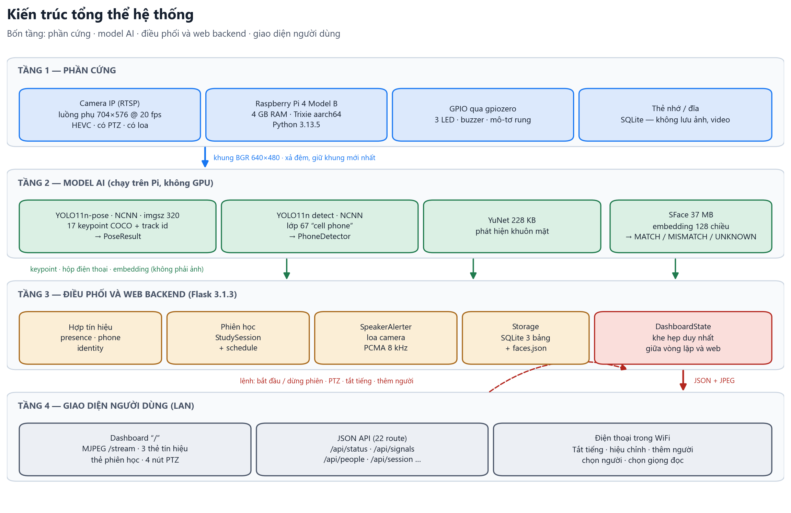
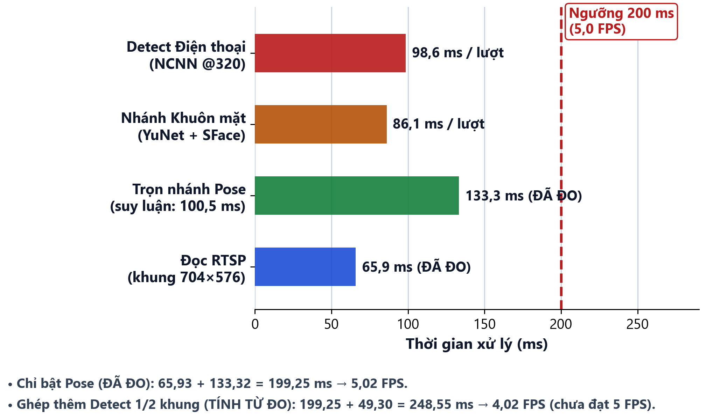

## CHƯƠNG 1. GIỚI THIỆU BÀI TOÁN VÀ MỤC TIÊU ĐỀ TÀI

### 1.1. Bối cảnh thực tiễn và phát biểu bài toán

Trong hoạt động tự học tại nhà hoặc ký túc xá, chất lượng một phiên học kéo dài 45 đến 90 phút thường suy giảm do ba hành vi lặp lại: tự ý rời bàn quá lâu, cầm điện thoại giải trí, hoặc có người khác ngồi thay vào vị trí của người đã đăng ký. Bộ đếm giờ truyền thống không nhận biết được hành vi vật lý, trong khi dịch vụ AI đám mây lại phải đẩy video phòng riêng ra Internet gây độ trễ và rủi ro lộ lọt hình ảnh cá nhân.

Đề tài xây dựng **Hệ thống giám sát học tập trên Raspberry Pi 4 kết hợp Camera IP và Ứng dụng di động** chạy khép kín trong mạng nội bộ (LAN). Khi phiên học được kích hoạt, Raspberry Pi 4 phân tích luồng RTSP trực tiếp để đánh giá ba trạng thái: hiện diện (`Presence`), dùng điện thoại (`Phone Use`) và danh tính (`Learner Identity`). Vi phạm kéo dài vượt ngưỡng giữ (`hold time`) sẽ đồng thời phát câu nhắc tiếng Việt ra loa tích hợp của camera IP, cập nhật lên Web và App di động, và ghi vào SQLite mà không lưu ảnh thô ra đĩa. Bảng 1 ánh xạ nhu cầu thực tế sang giải pháp kỹ thuật của đề tài.

*Bảng 1. Nhu cầu thực tiễn tại bàn học và giải pháp kỹ thuật biên của đề tài*

| STT | Nhu cầu thực tiễn | Hạn chế cách làm thông thường | Giải pháp tận dụng và cải tiến trong đề tài |
|---|---|---|---|
| 1 | Phát hiện rời bàn quá hạn | Cảm biến PIR báo sai khi ngồi yên; chọn hộp lớn nhất dễ nhảy người | Khóa vết `track id` `120 s` trên `YOLO11n-pose`, đếm `>= 2/7` điểm thân trên kèm ân hạn `3,0 s` |
| 2 | Phát hiện cầm điện thoại | Chỉ dò hộp sẽ báo nhầm máy để trên bàn hoặc nhầm gọng kính cận | Chạy `YOLO11n` cách khung `1/2`, chuẩn hóa khoảng cách cổ tay theo vai và lọc `phone_like_filter` |
| 3 | Xác thực đúng người học | Chia nhị phân đúng/sai gây báo giả liên tục khi cúi mặt viết bài | Tận dụng `YuNet + SFace` gốc OpenCV, quét 5 góc mặt tự suy ngưỡng, tách `MATCH / MISMATCH / UNKNOWN` |
| 4 | Nhắc nhở âm thanh gọn nhẹ | Nối loa rời qua cổng âm thanh tốn mạch khuếch đại và dây dẫn | Khai thác thẳng loa tích hợp trên camera IP qua RTSP backchannel chuẩn G.711 PCMA `8 kHz` |
| 5 | Giám sát và xem log trên di động | Mở trình duyệt gõ IP bất tiện; nhật ký thiếu ngày giờ chi tiết | Xây dựng App Expo SDK 58 gồm 7 tab, quét mặt 5 bước, giao diện Sáng/Tối và log lỗi thời gian thực |
| 6 | Bảo vệ quyền riêng tư | Lưu ảnh chụp vi phạm ra thẻ nhớ tiềm ẩn nguy cơ rò rỉ dữ liệu | Xử lý hoàn toàn trên RAM, lọc `scrub_biometrics` trên API và tự che mật khẩu luồng RTSP |

Bảng 1 cho thấy trọng tâm kỹ thuật của đề tài là tận dụng các mô hình pretrained gọn nhẹ kết hợp cải tiến thuật toán hậu xử lý hình học, lập lịch CPU biên và đồng bộ trải nghiệm phần cứng với ứng dụng di động.

### 1.2. Mục tiêu kỹ thuật và phạm vi thực hiện

Đề tài hướng tới năm mục tiêu cụ thể: (1) chạy ổn định trên Raspberry Pi 4 không GPU rời với nhiệt độ dưới ngưỡng hãm xung `80 °C`; (2) thêm người học mới trực tiếp trên Web và App qua 5 bước quét mặt không cần huấn luyện lại trọng số; (3) triệt tiêu độ trễ đệm và lỗi treo khung hình cũ trên mạng Wi-Fi/Hotspot chập chờn; (4) cam kết không lưu ảnh thô trên bộ nhớ ngoài; và (5) kiểm thử tự động độc lập phần cứng kèm quy ước minh bạch số liệu. Hệ thống tập trung giám sát một người học mục tiêu đối với ba vi phạm cốt lõi, chủ động đặt ngoài phạm vi bài toán chống giả mạo ảnh in (`anti-spoofing`) và đồng bộ đám mây; đồng thời lược bỏ phần lý thuyết giáo khoa của các mô hình để đi thẳng vào kỹ thuật tận dụng và cải tiến thực tế.

### 1.3. Kết chương

Chương 1 đã xác lập bài toán giám sát phiên học tại biên bảo toàn quyền riêng tư và định hình sáu nhóm giải pháp thực tiễn. Chương 2 tiếp theo trình bày kiến trúc bốn tầng, chín phân hệ một chiều và cải tiến luồng thu nhận RTSP trên Raspberry Pi 4.

## CHƯƠNG 2. KIẾN TRÚC HỆ THỐNG VÀ TỐI ƯU LUỒNG DỮ LIỆU BIÊN

### 2.1. Kiến trúc bốn tầng và chín phân hệ một chiều

Hệ thống tuân thủ bốn nguyên lý thiết kế: luôn xử lý khung mới nhất không xếp hàng đợi (`Latest-frame`), trao đổi giữa vòng lặp thị giác và máy chủ web qua khe hẹp duy nhất có khóa luồng (`DashboardState`), không ghi ảnh xuống đĩa (`Zero Disk Image Footprint`), và suy giảm nhẹ nhàng khi ngoại vi lỗi (`Graceful Degradation`). Hình 1 minh họa kiến trúc bốn tầng của hệ thống.

*Hình 1. Kiến trúc tổng thể bốn tầng của hệ thống giám sát học tập trên Raspberry Pi 4*

Như thể hiện ở Hình 1, gói mã nguồn `src/posture_monitor/` được phân rã thành chín phân hệ phụ thuộc một chiều từ trên xuống dưới nhằm loại bỏ phụ thuộc vòng. Trách nhiệm và cải tiến kỹ thuật tại từng phân hệ được tóm tắt trong Bảng 2.

*Bảng 2. Tổ chức chín phân hệ một chiều và các cơ chế an toàn cốt lõi*

| Phân hệ | Mô-đun chính | Giải pháp tận dụng và cải tiến kỹ thuật áp dụng | Phụ thuộc |
|---|---|---|---|
| `core/` | `config`, `atomic_io`, `credentials`, `log_buffer` | Kiểm tra kiểu `config.yaml`; ghi JSON nguyên tử `fsync` + `replace`; che mật khẩu RTSP; đệm vòng log | Độc lập |
| `camera/` | `capture`, `control`, `audio` | Đọc nền RTSP xả đệm, tự nối lại `60 lần`; xoay ONVIF PTZ xung `0,4 s`; phát RTP/PCMA `8 kHz` | `core/` |
| `hardware/` | `gpio_real`, `gpio_mock`, `sensors` | Điều khiển LED, còi, rung và siêu âm HC-SR04 qua `gpiozero`, tự dùng `MockFactory` trên PC | `core/` |
| `storage/` | `sqlite_store` | SQLite chế độ `WAL` gom lô `10 s` bảo vệ microSD, đóng phiên mồ côi và xả tức thời khi đọc vi phạm | `core/` |
| `vision/` | `yolo_loader`, `pose`, `phone_detector`, `phone`, `faces` | Nạp dự phòng `NCNN -> ONNX -> PT`, khóa `track id`, lọc hình học gọng kính và `YuNet + SFace` | `core/` |
| `domain/` | `presence`, `study_session`, `schedule`, `people_service` | Nghiệp vụ thuần tiêm thời gian ngoài, cổng phiên học hai lớp, quét mặt 5 bước và bảng 3 tín hiệu | `vision/`, `core/` |
| `alerts/` | `speaker_alert`, `voice_library`, `espeak_synth` | Ưu tiên cảnh báo (`sai người > điện thoại > rời bàn`) với 3 tầng dự phòng giọng đọc và âm bíp | `camera/`, `domain/` |
| `web/` | `app`, `state`, `streaming`, `privacy`, `routes/*` | 24 route Flask qua `DashboardState` không chặn camera; lọc `scrub_biometrics()` tước vector khỏi JSON | Cấm gọi thẳng AI |
| `cli/` | `monitor_runner`, `cmd_run`, `benchmark/` | Lắp ráp toàn tuyến giám sát và công cụ `benchmark` 3 hồ sơ đo hiệu năng chuẩn hóa | Tầng đỉnh |

Nhờ cấu trúc một chiều tại Bảng 2, toàn bộ thuật toán trong `vision/` và `domain/` hoàn toàn độc lập phần cứng, cho phép kiểm thử tự động hàng nghìn ca biên trên máy tính chỉ trong vài giây.

### 2.2. Cải tiến thu nhận RTSP và tự phục hồi trên mạng Hotspot

Khi đọc camera IP `20 fps` bằng cấu hình mặc định trên CPU biên xử lý `~4-5 fps`, bộ đệm giải mã nhanh chóng bị dồn ứ làm hình ảnh trễ hàng chục giây, hoặc rớt luồng vĩnh viễn khi sóng Wi-Fi nghẽn. Đề tài cải tiến `camera/capture.py` bằng ba kỹ thuật thực chiến:

1. **Đọc luồng phụ `704×576` kèm cờ FFmpeg độ trễ thấp và luồng nền `prefetch`:** Chọn luồng phụ `/1/2` sát kích thước suy luận `320`, truyền cờ `rtsp_transport;udp|fflags;nobuffer+discardcorrupt|flags;low_delay|framedrop;1` và chạy luồng nền liên tục ghi đè duy nhất khung mới nhất lên biến `_latest` (ở chế độ đồng bộ thì xả `grab()` tới ngưỡng `30 ms`), triệt tiêu hoàn toàn độ trễ tích lũy.
2. **Tách ngân sách tự kết nối lại `60 chu kỳ` chịu lỗi mạng Hotspot:** Thực nghiệm trên mạng Hotspot điện thoại (`172.20.10.x`) ghi nhận các đợt nghẽn sóng kéo dài `30-35 giây` khiến ngân sách cũ (`3 lần`) bỏ cuộc sớm. Hệ thống tách riêng số lần mở lúc khởi động (`3 lần` để báo lỗi nhanh nếu sai IP) với ngân sách phục hồi khi đang chạy **`RTSP_RECONNECT_ATTEMPTS = 60` lần** cách nhau **`2,0 giây`**, tự nạp lại đầy ngân sách ngay khi có khung mới, chịu được đứt mạng hơn hai phút.
3. **Xóa khung đóng băng khi luồng ngừng hẳn:** Khắc phục lỗi biến `_latest` giữ mãi tấm ảnh cũ trước lúc rớt mạng làm AI chấm lặp vô nghĩa trong khi đồng hồ phiên học vẫn đếm; nay hễ `_gave_up = True`, hệ thống lập tức xóa `_latest = None` để ngắt suy luận giả và bật cảnh báo `stale = true`.

### 2.3. Môi trường phần cứng triển khai và quy ước nhãn số liệu

Mọi chỉ số hiệu năng trong báo cáo tuân thủ ba nhãn bằng chứng: **`ĐÃ ĐO`** (đo trực tiếp trên thiết bị thật của dự án), **`TÍNH TỪ ĐO`** (suy ra bằng công thức đại số từ số `ĐÃ ĐO`), và **`CHƯA ĐO`** (chưa chạy bài đo khép kín trên phần cứng đích). Bảng 3 tổng hợp thông số môi trường triển khai thực tế.

*Bảng 3. Thông số môi trường phần cứng Raspberry Pi 4 triển khai thực tế*

| Hạng mục kỹ thuật | Thông số thực tế trên hệ thống đích | Nhãn |
|---|---|---|
| Bo mạch & Vi xử lý | Raspberry Pi 4 Model B **Rev 1.5**, ARMv8 `aarch64` (4 nhân Cortex-A72), RAM khả dụng **3.795 MB** | **ĐÃ ĐO** |
| Hệ điều hành & Nền tảng | Raspberry Pi OS **Trixie** (Debian 13), kernel `6.18.34+rpt-rpi-v8`, Python **3.13.5**, trống **7,6 GB** | **ĐÃ ĐO** |
| Nguồn hình & Ngoại vi mạng | Camera IP luồng phụ `/1/2` **704×576 @ 20 fps** (HEVC), ONVIF cổng `80`, Backchannel cổng `554` | **ĐÃ ĐO** |
| Nhiệt độ & Xung nhịp tải | Tăng từ **55,0 °C** lên **58,0 °C**, đỉnh **58,9 °C** (`< 80 °C`), `get_throttled = 0x0` suốt bài đo `60 s` | **ĐÃ ĐO** |

Các thông số tại Bảng 3 xác nhận nền tảng phần cứng ổn định tuyệt đối về nguồn và nhiệt, làm cơ sở cho tầng tối ưu mô hình AI ở Chương 3.

### 2.4. Kết chương

Chương 2 đã trình bày kiến trúc bốn tầng, chín phân hệ một chiều bảo vệ quyền riêng tư và ba cải tiến thu nhận RTSP chống trễ và chống treo ảnh cũ. Chương 3 tiếp theo phân tích cách tận dụng và cải tiến bốn mô hình AI trên Raspberry Pi 4.

## CHƯƠNG 3. TẬN DỤNG VÀ CẢI TIẾN CÁC MÔ HÌNH AI TRÊN THIẾT BỊ BIÊN

### 3.1. Lập lịch đa chu kỳ theo cổng phiên học hai lớp

Nếu gọi đồng loạt bốn mô hình (`YOLO11n-pose`, `YOLO11n`, `YuNet`, `SFace`) trên mọi khung hình, tổng thời gian xử lý vượt `350 ms/khung` làm tốc độ tụt dưới `3 FPS`. Đề tài giải quyết bằng chiến lược **lập lịch ba chu kỳ kết hợp cổng phiên học hai lớp (`StudySession` VÀ `Schedule`)** như minh họa tại Hình 2.

*Hình 2. Sơ đồ điều phối ba chu kỳ mô hình AI hợp nhất về bảng tín hiệu trung tâm `SignalBoard`*

Quan sát Hình 2, tần suất gọi từng mô hình được phân bổ sát với tốc độ biến thiên vật lý của tín hiệu và đóng/mở chặt theo trạng thái phiên học như tổng hợp trong Bảng 4.

*Bảng 4. Chiến lược tận dụng và lập lịch bốn mô hình pretrained trên Raspberry Pi 4*

| Mô hình tận dụng | Định dạng chạy | Đầu ra khai thác thực tế | Chiến lược lập lịch tiết kiệm CPU áp dụng |
|---|---|---|---|
| **YOLO11n-pose** | NCNN (`@320`, `11,5 MB`) | Hộp người có `track id`, 7 điểm thân trên & 2 cổ tay | **Chỉ bật khi phiên học `running`**, chạy mỗi khung để bám sát tay và thân trên |
| **YOLO11n detect** | NCNN (`@320`, `10,5 MB`) | Riêng lớp `67` (`cell phone`) của tập COCO | **Chỉ bật khi phiên mở** và **thấy cổ tay**, chạy **cách khung `1/2`** kèm `TTL = 0,5 s` |
| **YuNet** | ONNX (`227 KB`) | Hộp mặt `>= 40 px` và 5 điểm mốc mắt - mũi - miệng | Chạy định kỳ **mỗi `2,0 s`** trên khung gốc `704×576` cả ngoài và trong phiên học |
| **SFace** | ONNX (`36,9 MB`) | Vector đặc trưng 128 chiều chuẩn hóa đơn vị | Chạy **mỗi `2,0 s` có điều kiện** ngay khi YuNet vừa tìm thấy khuôn mặt hợp lệ |

Chiến lược tại Bảng 4 giúp CPU hoàn toàn nghỉ chạy hai mô hình nặng nhất khi chưa vào giờ học, đồng thời xóa sạch mọi bộ đếm tích lũy tại biên bật/tắt phiên để tránh báo động giả đầu phiên mới.

### 3.2. Tận dụng YOLO11n-pose và cải tiến bám vết hiện diện thân trên

Giữ nguyên trọng số `YOLO11n-pose` gốc, đề tài bổ sung bốn cải tiến kỹ thuật bao bọc quanh mô hình trong `vision/yolo_loader.py`, `vision/pose.py` và `domain/presence.py`:

1. **Chuỗi nạp dự phòng tự động `NCNN -> ONNX -> PyTorch`:** Ưu tiên biên dịch và nạp `NCNN` khai thác tập lệnh NEON trên ARM64 (trung vị suy luận thuần `107,3 ms`, **ĐÃ ĐO**), nhưng tự động lùi sang `ONNX` hoặc `.pt` kèm nhật ký cảnh báo nếu môi trường phát triển thiếu thư viện biên dịch.
2. **Khóa cứng `track id` trong `120 giây` chống nhảy người:** Thay thế quy tắc lấy hộp diện tích lớn nhất (vốn nhảy ngay sang người thân đi ngang phía sau làm mất cảnh báo rời bàn) bằng cơ chế khóa định danh `track id`: khi mất dấu chưa quá `absent_reset_s = 120 s`, hệ thống kiên quyết giữ kết luận vắng mặt của chủ nhân và tự lùi mềm về `predict` nếu bộ bám vết nội bộ gặp lỗi.
3. **Kiểm định hiện diện từ nhóm điểm thân trên thay vì hộp bao:** Để không nhận nhầm áo khoác vắt trên lưng ghế là có người, `presence.py` yêu cầu đối tượng khóa phải có **tối thiểu `2/7` điểm vùng đầu - vai đạt `conf >= 0,50`**, kèm thời gian ân hạn `3,0 giây` trước khi tính ngưỡng giữ rời bàn (`5,0 giây`).
4. **Lược bỏ cảnh báo âm thanh sai tư thế (`posture_labels_enabled: false`):** Vẫn tính điểm tư thế thang `100` (qua lọc trung vị `1,0 s` và trễ `hysteresis`) cho giao diện di động, nhưng chặn phát loa các lỗi nghiêng vai/cúi đầu để tránh làm phiền người học ngoài ba vi phạm chính.

### 3.3. Tận dụng YOLO11n và chuỗi cải tiến triệt tiêu báo nhầm điện thoại

Thực nghiệm ở khoảng cách ngồi `0,8 - 1,2 m` phát hiện ba rào cản khiến cách gọi `YOLO11n` đơn thuần thất bại hoàn toàn: (1) điện thoại bị bàn tay che một phần trên NCNN chỉ đạt độ tin cậy thấp (`0,06 - 0,236`), chồng lấn thẳng với điểm nhận nhầm **gọng kính cận trên mặt thành điện thoại (`0,023 - 0,068`, ĐÃ ĐO)**; (2) cổ tay đang nắm máy bị che giảm độ tin cậy xuống `0,35 - 0,43` (dưới ngưỡng `0,50`); và (3) khoảng cách từ khớp cổ tay tới mép hộp điện thoại cách nhau `112 - 138 px` làm ngưỡng đè hộp `0 px` thất bại **`0/40 khung`** (**ĐÃ ĐO**). Đề tài giải quyết dứt điểm không cần huấn luyện lại bằng năm cải tiến phối hợp tại Bảng 5.

*Bảng 5. Năm cải tiến trên nhánh phát hiện điện thoại và hiệu quả đo kiểm thực tế*

| Cải tiến kỹ thuật áp dụng | Tham số chuẩn | Hiệu quả thực nghiệm và vai trò thực tế (**ĐÃ ĐO**) |
|---|---|---|
| **1. Cổng cổ tay khả dụng (`Wrist Gate`)** | `wrist_conf_min = 0,25` | Giữ được cổ tay cầm máy (`0,35 - 0,43`); nếu khuất cả hai cổ tay thì **bỏ qua luôn lượt gọi `YOLO11n`** để tiết kiệm CPU |
| **2. Hạ ngưỡng nhạy kết hợp chạy cách khung** | `conf = 0,06`, `1/2 khung`, `box_ttl_s = 0,5 s` | Bắt nhạy điện thoại bị ngón tay che; giảm `50%` chi phí gọi detect (`98,6 ms/lượt`) mà không đứt quãng nhờ giữ hộp sống `0,5 s` |
| **3. Chuẩn hóa khoảng cách chạm theo vai** | `shoulder_ratio = 1,0` | Đặt bán kính chạm bằng `1,0 × bề rộng vai`, phủ trọn khoảng cách thực `0,70 - 0,86 × vai` (**bắt `40/40 khung`**) và tự co giãn theo cự ly ngồi |
| **4. Lọc đường vai `phone_like_filter` & van `oversize`** | `above <= 10 px`, `size >= 0,45`, `oversize = 2,25` | Loại hộp cao hơn đường vai quá `10 px` hoặc nhỏ hơn `0,45 × vai`: **giữ `8/8` hộp thật, loại sạch `24/24` hộp giả gọng kính**; miễn trừ khi giơ sát mặt (`> 2,25 × vai`) |
| **5. Bộ lọc thời gian dung sai hụt khung** | `hold_s = 1,0 s`, `miss_tolerance = 4` | Phải chạm liên tục `1,0 s` mới báo loa, cho phép hụt tối đa `4 khung` nhòe chuyển động liên tiếp không bị xóa bộ đếm về `0` |

Bảng 5 chứng minh việc mượn mốc giải phẫu đường vai và cổ tay từ mô hình pose để lọc không gian cho mô hình detect đã loại bỏ `100%` lỗi báo nhầm gọng kính chỉ bằng vài phép toán hình học cực nhẹ.

### 3.4. Tận dụng YuNet + SFace: hiệu chỉnh ngưỡng, quét 5 bước và ba trạng thái

Thay vì dùng `dlib` hay `insightface` nặng nề trên ARM64, đề tài khai thác trực tiếp `cv2.FaceDetectorYN` (`YuNet`) và `cv2.FaceRecognizerSF` (`SFace`) tích hợp sẵn trong C++ của OpenCV (tổng thời gian **`86,1 ms/lượt`**, **ĐÃ ĐO**) kèm bốn cải tiến sát thực tế:

1. **Giữ khung gốc `704×576` và hạ `score_threshold` từ `0,90` xuống `0,70`:** Phép đo thực tế chỉ ra mặt thật đạt `0,862 - 0,928` còn nhiễu nền tối đa chỉ `0,451`; hạ ngưỡng từ `0,90` về `0,70` nâng tỷ lệ bắt mặt ảnh tĩnh từ `7/10` lên **`10/10` ảnh (`100%`)** và tăng gấp bốn lần khi chống tay lên cằm (**từ `2/14` lên `8/14` khung, ĐÃ ĐO**).
2. **Quét đăng ký 5 góc mặt không lưu ảnh và tự suy ngưỡng cosine:** `EnrollmentTracker` hướng dẫn xoay 5 hướng (*Thẳng, Phải, Trái, Ngẩng, Cúi*, `1,5 s/bước`), thu tối thiểu `3/5` vector 128 chiều ghi nguyên tử vào `faces.json` (`~2,5 KB/người`) rồi hủy ảnh ngay trên RAM. Khi `match_threshold = null`, `ThresholdManager` tự suy ngưỡng an toàn từ độ tương đồng cặp thấp nhất giữa các mẫu vừa quét (kẹp trong `[0,30; 0,95]`) thay vì chép cứng số mẫu bên ngoài.
3. **Phân loại ba trạng thái (`MATCH`, `MISMATCH`, `UNKNOWN`) chống báo oan:** Mọi tình huống cúi gằm viết bài không thấy mặt, mặt `< 40 px` hoặc ngược sáng đều đi vào trạng thái trung tính **`UNKNOWN`** (không cộng dồn bộ đếm lỗi); chỉ khi thấy rõ khuôn mặt khác chủ nhân liên tục vượt `5,0 giây` (`MISMATCH`) mới kích hoạt cảnh báo `IMPOSTOR`.

### 3.5. Kết chương

Chương 3 đã trình bày cách tận dụng và cải tiến bốn mô hình AI từ lập lịch cổng phiên học, khóa vết `track id`, lọc gọng kính theo đường vai đến nhận diện khuôn mặt ba trạng thái. Chương 4 tiếp theo trình bày tích hợp ngoại vi camera IP, Web Dashboard và Ứng dụng di động.

## CHƯƠNG 4. TÍCH HỢP NGOẠI VI CAMERA IP, WEB DASHBOARD VÀ ỨNG DỤNG DI ĐỘNG

### 4.1. Loa RTSP Backchannel, điều khiển PTZ và xả tức thời SQLite

Đề tài biến chính chiếc camera IP thành thiết bị chấp hành hai chiều và tối ưu kho lưu trữ cục bộ thông qua ba cơ chế trong `camera/`, `alerts/` và `storage/`:

- **Cảnh báo giọng Việt qua RTSP Backchannel (`PCMA 8 kHz`) ba tầng dự phòng:** Đẩy luồng RTP `8.000 Hz` qua cổng `554` ra loa camera IP theo thứ tự ưu tiên `sai người > điện thoại > rời bàn` (lặp mỗi `2 s` khi còn lỗi). Ưu tiên phát giọng người thu sẵn (`giongnam`/`giongnu`, âm lượng `0,7`, tốc độ `0,9` qua `atempo`) đạt độ rõ **STOI `0,958 - 0,972`** vượt trội so với `0,929 - 0,945` của `espeak-ng` (**ĐÃ ĐO**), tự lùi xuống `espeak-ng` rồi âm bíp nếu thiếu tệp âm thanh.
- **Xoay ống kính ONVIF PTZ xung ngắn an toàn:** Tự suy địa chỉ từ `POSTURE_CAMERA_SOURCE`, gửi xung `continuous_move` `0,4 giây` qua cổng `80` và ép gọi `stop()` trong khối `finally` để camera không bao giờ kẹt quay quá đà khi mạng trễ.
- **Cải tiến xả tức thời (`Immediate Flush`) trên SQLite `WAL`:** Cơ sở dữ liệu `posture.db` gom lô `10 giây` để bảo vệ thẻ nhớ microSD, nhưng hàm `Storage.violations()` được cải tiến tự gọi `self.flush()` ngay trước lệnh `SELECT` mỗi khi `_pending_events` có bản ghi mới, giúp vi phạm vừa phát sinh hiện lên giao diện tức thì không trễ `10 giây`.

### 4.2. Máy chủ Flask khe hẹp DashboardState và Web Offline-first

Máy chủ Flask (`port 8000`) giao tiếp độc quyền với vòng lặp camera qua `DashboardState`: hàm `wait_frame()` nhả khóa khi ngủ chờ từng nhịp `50 ms` để khách hàng mạng chậm không chặn vòng lặp AI, đồng thời luồng `/stream` cấp sẵn ảnh JPEG xám `320×240` hợp lệ lúc mới mở để trình duyệt không vỡ luồng `multipart`. Giao diện Web thuần HTML/CSS/JS đóng gói sẵn phông `Geist woff2` tiếng Việt chạy hoàn toàn không cần Internet, hiển thị đồng thời màu + biểu tượng + chữ và tự đổi sang `"Chưa có dữ liệu mới"` khi `fresh = false`. Hình 3 minh họa Web Dashboard vận hành thực tế trên Raspberry Pi 4.

*Hình 3. Giao diện Web Dashboard tiếng Việt offline-first vận hành thực tế trên Raspberry Pi 4*

Trên Hình 3, hộp **Nhật ký vi phạm** của Web cũng đã được nâng cấp hiển thị đầy đủ cả giờ và ngày (`HH:MM:SS · DD/MM/YYYY`) và tự hủy truy vấn nền bằng `AbortController` ngay khi đóng hộp thoại.

### 4.3. Ứng dụng di động Expo SDK 58 và bốn cải tiến trải nghiệm thực tế

Ứng dụng di động phát triển bằng **React Native (`0.88.1`) / Expo SDK `58`** (`apps/mobile/`) gom mọi kết nối qua một cổng `client.ts` độc lập `react-native` (hạn chờ `5 s` JSON, `10 s` ảnh) và dùng `usePoll` tự gọi `AbortController.abort()` ngay khi rời tab. Từ phản hồi kiểm thử thực địa, ứng dụng được nâng cấp toàn diện như thể hiện trên Hình 4.

*Hình 4. Bố cục màn hình Camera hợp nhất 3 tín hiệu người học và kiến trúc 7 tab của ứng dụng di động*

Bốn cải tiến trọng tâm trên Hình 4 gồm: (1) **Màn `Camera` hợp nhất** đặt khung video `4:3` (tự động lùi từ `MJPEG /stream` sang `Ảnh tĩnh /api/frame` khi mạng Hotspot nghẽn) ngay trên cụm **3 Tín hiệu Bento 2+1** và **Trạng thái tư thế 2×2**; (2) **Tab `Người học` (`PeopleScreen`)** cho phép chọn/xóa hồ sơ và mở trực tiếp hộp **quét khuôn mặt 5 bước kiểu Face ID** ngay trên điện thoại; (3) **Giao diện kép Sáng / Tối** chuyển đổi tức thời ở mọi màn hình, lưu qua `AsyncStorage`; và (4) **Màn `Vi phạm` nâng cấp (`ViolationsScreen`)** sửa lỗi co chiều cao `FlatList` trên iOS, tự làm mới mỗi `4 giây`, lọc theo mã lỗi và chia hai chế độ **`Vi phạm học`** (giờ + ngày `DD/MM/YYYY`, mã lỗi, nguyên nhân, thời lượng) cùng **`Log hệ thống`** (`/api/logs` trực tiếp từ Pi). Bảng 6 tóm tắt 7 tab của ứng dụng.

*Bảng 6. Cấu trúc 7 tab chức năng của ứng dụng di động sau khi nâng cấp*

| Tab | Tên Tab | Chức năng cốt lõi và cải tiến trải nghiệm | Endpoint API chính |
|---|---|---|---|
| **1** | **Camera** | Video 4:3 (`MJPEG` / tự lùi `Tĩnh`) + 3 tín hiệu Bento 2+1 + Tư thế 2×2 + Loa & Sáng/Tối | `/stream`, `/api/frame`, `/api/signals`, `/api/status` |
| **2** | **Người học** | Chọn người đang học, xóa hồ sơ và quét khuôn mặt 5 bước trực tiếp trên điện thoại | `/api/people`, `/api/select`, `/api/enroll/<id>` |
| **3** | **Phiên học** | Đặt số phút, bấm **Bắt đầu / Dừng học**, đồng hồ đếm ngược thời gian thực | `/api/session`, `/api/session/start`, `/stop` |
| **4** | **Điều khiển** | Bật/tắt tiếng loa cảnh báo và bàn phím xoay ống kính **PTZ** 4 hướng | `/api/mute`, `POST /api/ptz` |
| **5** | **Giọng đọc** | Đổi **Giọng Nam / Nữ / Máy**, cảnh báo rõ nếu giọng thiếu tệp thu âm gốc | `GET · POST /api/voice` |
| **6** | **Vi phạm** | Xem **Vi phạm học** (giờ + ngày, mã lỗi, chi tiết, thời lượng) và **Log hệ thống** Pi (`4 s`) | `GET /api/violations`, `GET /api/logs` |
| **7** | **Kết nối** | Lưu địa chỉ IP LAN của Pi, chặn nhập nhầm `localhost` và kiểm tra kết nối | `GET /api/status` |

Bảy tab tại Bảng 6 dùng chung nguồn dữ liệu duy nhất từ Flask trên Raspberry Pi 4, đảm bảo trạng thái đồng bộ tức thời giữa điện thoại và trình duyệt máy tính.

### 4.4. Kết chương

Chương 4 đã trình bày tích hợp loa backchannel, PTZ, xả tức thời SQLite cùng Web Dashboard và Ứng dụng di động 7 tab hỗ trợ Sáng/Tối, quét mặt 5 bước và xem log chi tiết. Chương 5 tiếp theo trình bày kết quả kiểm thử tự động và đo kiểm hiệu năng thực tế.

## CHƯƠNG 5. KIỂM THỬ HỆ THỐNG, ĐO LƯỜNG HIỆU NĂNG VÀ ĐÁNH GIÁ

### 5.1. Kiểm thử tự động hai nền tảng độc lập phần cứng

Nhờ kiến trúc tiêm phụ thuộc và tách lớp API thuần, toàn bộ logic Backend Python lẫn Mobile App đều chạy kiểm thử tự động trên máy tính không cần gắn Raspberry Pi hay camera thật. Bảng 7 tổng hợp quy mô và kết quả kiểm thử.

*Bảng 7. Quy mô và kết quả bộ kiểm thử tự động hai nền tảng của dự án*

| Nền tảng & Nhóm kiểm thử | Quy mô | Kết quả | Trọng tâm kiểm chứng kỹ thuật |
|---|---|---|---|
| **Backend: `core`, `storage`, `hardware`, `camera`** | `18 tệp` · `412 bài` | `100% PASS` | `config.yaml`, ghi nguyên tử `fsync`, che mật khẩu, SQLite `WAL` đa luồng, RTSP, PTZ, RTP/PCMA |
| **Backend: `vision`, `domain`, `alerts`** | `27 tệp` · `884 bài` | `880 PASS` (`4 skip`) | Khóa `track id`, hiện diện thân trên, lọc gọng kính, quét mặt 5 bước, `StudySession`, loa 3 tầng |
| **Backend: `web`, `cli`, `integration`** | `15 tệp` · `366 bài` | `100% PASS` | 24 route HTTP, `scrub_biometrics`, luồng MJPEG, nối dây vòng lặp và hàng rào chống số liệu sai |
| **Mobile: Logic Node & UI DOM (`apps/mobile`)** | `9 tệp` · **`201 bài`** | **`201/201 PASS`** | Chuẩn hóa payload/lỗi Việt, giao diện Sáng/Tối, quản lý Người học & quét mặt, hủy `AbortController` |
| **Tổng cộng toàn dự án** | **`69 tệp` · `1.863 bài`** | **`0 FAIL`** | Bảo chứng toàn diện từ thuật toán hình học biên đến giao diện người dùng (`tsc` `0 lỗi`) |

Bộ **`1.863 bài kiểm thử`** (`1.662` bài Python và `201` bài Mobile) tại Bảng 7 đã khóa chặt các lỗi biên quan trọng như xung đột khóa SQLite đa luồng, đua thời gian phát loa hết giờ và đồng bộ trạng thái Sáng/Tối trên React 19.

### 5.2. Ngân sách thời gian, tốc độ FPS và nhiệt độ trên Raspberry Pi 4

Công cụ `posture_monitor benchmark` đo trực tiếp phân bố độ trễ, RAM `RSS` và nhiệt độ CPU trên Raspberry Pi 4. Hình 5 biểu diễn ngân sách thời gian một khung hình so với mốc mục tiêu `200 ms` (`5,0 FPS`).

*Hình 5. Ngân sách thời gian các khâu xử lý đo thực tế trên Raspberry Pi 4 so với mốc 200 ms (5 FPS)*

Đối chiếu Hình 5, độ trễ từng thành phần và kết quả đối chiếu tiêu chí nghiệm thu trên phần cứng thật được tổng hợp tại Bảng 8.

*Bảng 8. Kết quả đo hiệu năng trên Raspberry Pi 4 và đối chiếu tiêu chí nghiệm thu*

| Hạng mục đo kiểm | Kết quả thực tế trên Pi 4 | Điều kiện đo / Công thức | Nhãn & Đánh giá |
|---|---|---|---|
| Suy luận thuần `YOLO11n-pose` (`@320`) | Trung vị **`107,3 ms`** (`p95 = 116,2 ms`) | Lặp `549 lượt` trên ảnh `640×480` | **ĐÃ ĐO** (Ổn định) |
| Suy luận thuần `YOLO11n` detect (`@320`) | **`98,6 ms / lượt`** (lặp lại `98,7 ms`) | Khung thử nghiệm `640×480` | **ĐÃ ĐO** (Khớp dự kiến) |
| Nhánh khuôn mặt (`YuNet + SFace`) | **`86,1 ms / lượt`** (chu kỳ `2,0 s` -> `< 4,5%` quỹ thời gian) | Phát hiện + căn chỉnh + trích vector | **ĐÃ ĐO** (Rất nhẹ) |
| Đường ống thật chỉ bật `pose` | **`199,25 ms`** (`capture 65,93` + `pose 133,32 ms`) -> **`5,02 FPS`** (lặp 8 lần trung vị **`4,96 FPS`**) | Chạy `60 s` liên tục trên RTSP `704×576` | **ĐÃ ĐO / TÍNH TỪ ĐO** (Sát biên `5 FPS`) |
| Đường ống ghép `pose + phone (1/2)` | `199,25 + 98,60 / 2 =` **`248,55 ms`** -> **`4,02 FPS`** | Suy từ đường ống thật + detect cách khung | **TÍNH TỪ ĐO** (Đủ cho `hold_s = 1,0 s`) |
| Nhiệt độ, nguồn và bộ nhớ RAM | Đỉnh **`58,9 °C`** (`< 80 °C`), `throttled = 0x0`, `RSS` **`464,0 MiB`** | Lấy mẫu mỗi `5 s` suốt phiên tải | **ĐÃ ĐO** (An toàn rộng) |

Từ Bảng 8, cấu hình chỉ `pose` chạm mốc `5,0 FPS`, còn khi bật thêm dò điện thoại cách khung đạt khoảng **`4,02 FPS`** (trọn 3 nhánh đồng thời giữ nhãn **`CHƯA ĐO`** benchmark khép kín). Với ngưỡng giữ hành vi `1,0 - 5,0 s`, nhịp `~4 FPS` đảm bảo phát hiện nhạy và giữ CPU mát dưới `59 °C`.

### 5.3. Đánh giá thực địa mạng LAN so với Hotspot và giới hạn kỹ thuật

Thực nghiệm đối chiếu hai môi trường mạng cho thấy rõ giá trị của các cơ chế chịu lỗi đã xây dựng: trên **Router Wi-Fi LAN (`192.168.17.x`)**, độ trễ nội bộ chỉ **`2 - 8 ms`**, luồng MJPEG `/stream` và loa cảnh báo phản hồi tức thì; ngược lại trên **Hotspot điện thoại (`172.20.10.x`)**, sóng bán song công gánh hai chiều video làm ping tăng lên trung bình **`178 - 207 ms`**, vọt đỉnh **`368 - 447 ms`** (**ĐÃ ĐO**) kèm các nhịp nghẽn `> 30 s`. Nhờ tự nối lại RTSP `60 lần`, tự lùi sang `Ảnh tĩnh` và hủy socket tab ẩn bằng `AbortController`, hệ thống vẫn tự hồi phục và ghi nhận chuẩn xác các bản ghi `PHONE_USE` và `IMPOSTOR`. Các giới hạn hiện tại được ghi nhận rõ gồm: chiếu 2D có thể báo chạm nếu để điện thoại sát cổ tay viết bài `> 1,0 s`; góc camera quá cao che khuất cổ tay sẽ chặn cổng `wrist_conf_min` (chỉnh nhanh bằng nút PTZ xuống); chưa có chống giả mạo ảnh in khuôn mặt và nút hiệu chỉnh trực tiếp trên luồng Web.

### 5.4. Kết chương

Chương 5 đã kiểm chứng hệ thống qua `1.863` bài kiểm thử tự động, phân tích ngân sách thời gian `199,25 ms` trên Raspberry Pi 4 và đối chiếu vận hành trên mạng LAN cùng Hotspot. Chương 6 tiếp theo tổng kết kết quả và hướng phát triển của đề tài.

## CHƯƠNG 6. KẾT LUẬN VÀ HƯỚNG PHÁT TRIỂN

### 6.1. Kết luận chung

Đề tài đã hoàn thành trọn vẹn hệ thống giám sát học tập tại biên trên Raspberry Pi 4 kết hợp Camera IP và Ứng dụng di động chạy khép kín trong mạng LAN. Năm kết quả cải tiến cốt lõi đạt được gồm: (1) tối ưu luồng phụ RTSP `704×576` xả đệm trực tiếp, tự kết nối lại `60 chu kỳ` trên mạng Hotspot và xóa khung đóng băng; (2) điều phối 4 mô hình pretrained theo 3 chu kỳ dưới cổng phiên học hai lớp, tiêu thụ chỉ `464 MiB` RAM ở `58,9 °C`; (3) xây dựng bộ lọc hình học thực nghiệm gồm khóa `track id` `120 s`, khoảng cách cổ tay `1,0 × vai`, lọc `phone_like_filter` loại sạch `24/24` hộp giả gọng kính và nhận diện mặt 3 trạng thái không báo oan khi cúi viết; (4) tận dụng loa tích hợp camera qua RTSP backchannel PCMA `8 kHz` (STOI `0,958 - 0,972`) và ONVIF PTZ bảo toàn quyền riêng tư không lưu ảnh; và (5) xây dựng Web Dashboard offline-first cùng App Expo SDK 58 gồm 7 tab (giao diện Sáng/Tối, quét mặt 5 bước, xả tức thời SQLite và xem chi tiết Nhật ký vi phạm cùng Log hệ thống), bảo chứng bởi `1.863` bài kiểm thử tự động.

### 6.2. Hạn chế còn tồn tại và hướng phát triển

Từ các giới hạn đã phân tích ở Chương 5, lộ trình nâng cấp tiếp theo của hệ thống được tổng hợp tại Bảng 9.

*Bảng 9. Lộ trình cải tiến kỹ thuật ở các giai đoạn tiếp theo*

| Giai đoạn | Tầng kỹ thuật | Nội dung cải tiến trọng tâm |
|---|---|---|
| **Ngắn hạn** | Đo kiểm & Web UI | Đo benchmark khép kín hồ sơ `pose_phone_face`; hiệu chuẩn thống kê 4 hằng số bắt lại `track id`; nối trực tiếp nút hiệu chỉnh sống và lưu `data/schedule.json` |
| **Trung hạn** | Thị giác AI biên | Lượng tử hóa `INT8` NCNN hoặc giảm `imgsz = 256` để vượt `5,0 FPS` đa mô hình; thêm `CLAHE` chống ngược sáng và kiểm tra chớp mắt chống giả mạo ảnh in |
| **Dài hạn** | Phần cứng & App | Đóng gói bản cài `.apk` độc lập có thông báo đẩy nội bộ (Local Notification) và tích hợp NPU rời (Hailo-8L / Coral) khi mở rộng nhiều bàn học |

Các hướng nâng cấp tại Bảng 9 đều lắp ghép trực tiếp trên nền chín phân hệ một chiều hiện có mà không phá vỡ cấu trúc cốt lõi.

## CHƯƠNG 7. TÀI LIỆU THAM KHẢO

[1] Glenn Jocher, Jing Qiu và cộng sự (2024), *Ultralytics YOLO11 Technical Documentation*, https://docs.ultralytics.com/.

[2] Tencent Nihui và cộng sự (2025), *ncnn: High-performance neural network inference framework for ARM*, https://github.com/Tencent/ncnn.

[3] Wei Wu, Hanyang Peng, Shiqi Yu (2023), *YuNet: A Fast and Accurate CNN-based Face Detector*, Machine Intelligence Research, 20, tr. 656-665.

[4] Yaoyao Zhong, Weihong Deng và cộng sự (2021), *SFace: Sigmoid-Constrained Hypersphere Loss for Robust Face Recognition*, IEEE TIP, 30, tr. 2587-2598.

[5] OpenCV Team (2025), *OpenCV Objdetect Module (`FaceDetectorYN` & `FaceRecognizerSF`)*, https://docs.opencv.org/.

[6] Raspberry Pi Ltd (2024), *Raspberry Pi 4 Model B Datasheet & Thermal Management*, https://www.raspberrypi.com/documentation/.

[7] ONVIF Forum (2022), *ONVIF Profile T: RTSP Audio Backchannel and PTZ Service*, https://www.onvif.org/profiles/profile-t/.

[8] Cees H. Taal và cộng sự (2011), *Short-Time Objective Intelligibility Measure (STOI)*, IEEE TASLP, 19(7), tr. 2125-2136.

[9] Ben Nuttall, Dave Jones (2024), *gpiozero & MockFactory Documentation*, https://gpiozero.readthedocs.io/.

[10] D. Richard Hipp & SQLite Consortium (2025), *Write-Ahead Logging (`WAL`) in SQLite*, https://www.sqlite.org/wal.html.

[11] Meta Platforms & Expo Team (2026), *React Native 0.88 & Expo SDK 58 Documentation*, https://docs.expo.dev/.

[12] Chính phủ Việt Nam (2023), *Nghị định số 13/2023/NĐ-CP về Bảo vệ dữ liệu cá nhân*.
